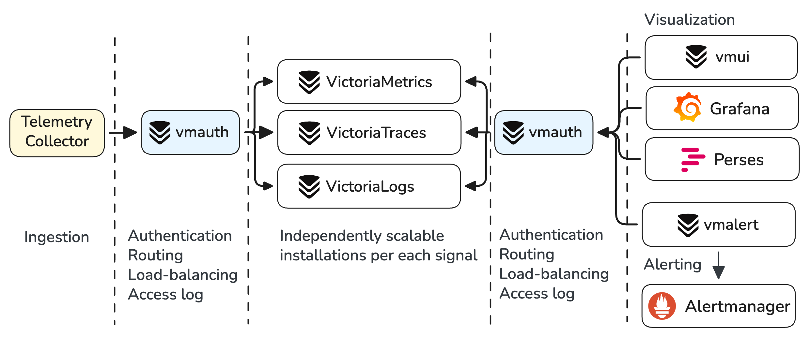
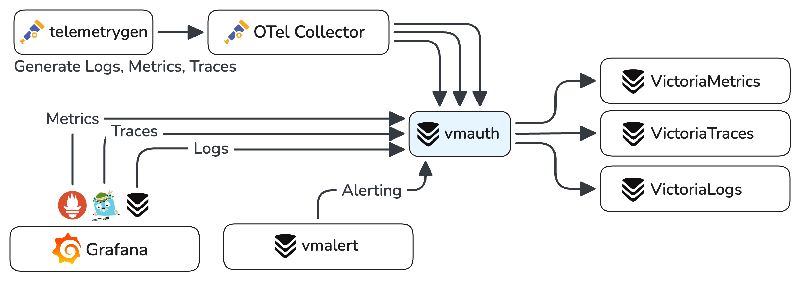
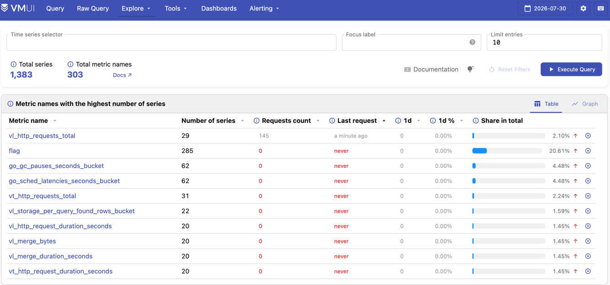
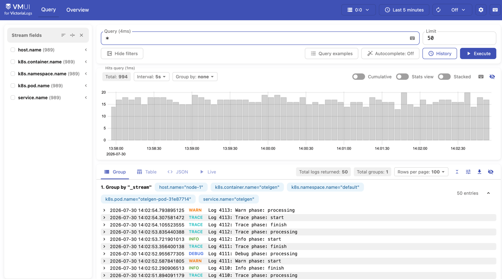
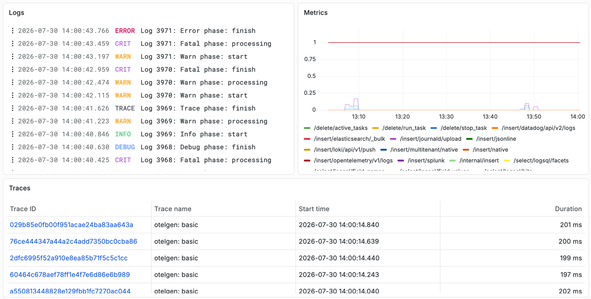

**VictoriaStack** is a unified observability platform built with three specialized databases that share the same
design philosophy, operational model, and ecosystem:

| Signal      | Product                                                              | Query language                                                                                                                                                                                                                                  | Scalability                                                                     |
|-------------|----------------------------------------------------------------------|-------------------------------------------------------------------------------------------------------------------------------------------------------------------------------------------------------------------------------------------------|---------------------------------------------------------------------------------|
| **Metrics** | [VictoriaMetrics](https://docs.victoriametrics.com/victoriametrics/) | [MetricsQL](https://docs.victoriametrics.com/metricsql/) (PromQL-compatible)                                                                                                                                                                    | Billions of [active time series](), Millions of [samples]() ingested per second |
| **Logs**    | [VictoriaLogs](https://docs.victoriametrics.com/victorialogs/)       | [LogsQL](https://docs.victoriametrics.com/victorialogs/logsql/)                                                                                                                                                                                 | Hundreds of TBs a day with avg compression ratio of x10                         |
| **Traces**  | [VictoriaTraces](https://docs.victoriametrics.com/victoriatraces/)   | [LogsQL](https://docs.victoriametrics.com/victorialogs/logsql/), [Jaeger API](https://docs.victoriametrics.com/victoriatraces/querying/#jaeger-http-api), [Tempo API](https://docs.victoriametrics.com/victoriatraces/querying/#tempo-http-api) | Millions of traces ingested per second                                          |

//todo: update scalability numbers for traces and logs
<br>

All three solutions support the following features out-of-the-box:

- [Horizontal scaling]()
- [Multitenancy]()
- [Alerting]()
- [Grafana integration]()
- [OpenTelemetry](https://docs.victoriametrics.com/opentelemetry/) for ingestion
- Apache 2 licensed

## Why VictoriaStack?

VictoriaStack software is built on three core principles: **simplicity, reliability, and efficiency**.
It is easy to run and maintain, it fits well in home labs and can be reliably scaled to large production
environments. Each of the databases was heavily battle-tested in production environments.

The stack is focusing on what matters most for each signal. VictoriaMetrics is optimized
for time series workload, while VictoriaLogs design and architecture are optimized for log ingestion.
The separation of storage backends allows keeping solutions simple, efficient, independent, and fine-tuned for each
signal.

It is well integrated into the modern observability ecosystem by supporting various protocols for ingestion
and User Interfaces like Grafana and Perses for querying. It supports multitenancy, alerting, out-of-order backfilling,
efficient compression, sane defaults for simplified setup, wide community and support.

VictoriaStack is the best choice if you want to own your observability stack, build a reliable and effieicient
multitenant
platform ready for future scaling and growth.

## Architecture Overview


{width="700"}

| What                       | How                                                                                                                                                                                                                                                   |
|----------------------------|-------------------------------------------------------------------------------------------------------------------------------------------------------------------------------------------------------------------------------------------------------|
| **Deployment**             | [Kubernetes operator](https://docs.victoriametrics.com/operator/), [Helm charts](https://docs.victoriametrics.com/helm/), Bare metal                                                                                                                  |
| **Ingestion integrations** | [OpenTelemetry collector](https://docs.victoriametrics.com/opentelemetry/), [Vector](https://vector.dev/), [Grafana Alloy](https://grafana.com/docs/alloy/latest/), 10+ additional integrations                                                       |
| **Native ingestion**       | **High troughput, reliable on-disk buffering, replication, traffic compression** via [vmagent](https://docs.victoriametrics.com/victoriametrics/vmagent/) for metrics and [vlagent](https://docs.victoriametrics.com/victorialogs/vlagent/) for logs. |
| **Access control**         | [vmauth](https://docs.victoriametrics.com/victoriametrics/vmauth/) for user's authentication, requests routing, load balancing.                                                                                                                       |
| **Visualization**          | [Grafana]() and [Perses]() for unified observability and dashboarding. Built-in [vmui]() for ad-hoc exploration.                                                                                                                                      |
| **Alerting**               | [vmalert]() integrated with [Alertmanager]() for rules evaluation and dispatching notifications                                                                                                                                                       |

// TODO: add links to stack components

## Quick Start

> If you're looking for a visual impression of the stack,
> visit [Playgrounds page](https://docs.victoriametrics.com/playgrounds/)
> and try publicly running installations of VictoriaStack, fed
> with [OpenTelemetry Astronomy Shop demo](https://github.com/open-telemetry/opentelemetry-demo) data.

### Single-node version

To run [the stack locally with docker compose](https://github.com/VictoriaMetrics/VictoriaStack/blob/main/deployment/otel-single-node-compose.yml)
run the following command:

```sh
git clone https://github.com/VictoriaMetrics/VictoriaStack.git
make otel-single-up
```

> Note: the Docker Compose environment is very much simplified for demonstration purposes; 
> it is **not intended for production use**.
> The data it ingests is not representative of real-world data. 

The compose command will start:
- OpenTelemetry collector + generator for telemetry signals;
- Single-node versions of VictoriaMetrics, VictoriaLogs, VictoriaTraces for storing and querying signals;
- vmalert for executing alerting rules;
- Grafana for visualizing signals;
- vmauth as a single entrypoint, that will authorize and route requests to the appropriate VictoriaStack component.



Once running, the following links will be available:

- [VictoriaMetrics UI - http://localhost:8427/metrics/select/vmui](http://localhost:8427/metrics/select/vmui/?#/cardinality)
  
  {width="500"}
- [VictoriaLogs UI - http://localhost:8427/logs/select/vmui](http://localhost:8427/logs/select/vmui)
  
  {width="500"}
- [VictoriaTraces UI - http://localhost:8427/traces/select/vmui](http://localhost:8427/traces/select/vmui), but it is better to
  use [Grafana](http://localhost:3000)
- [Grafana - http://localhost:3000](http://localhost:3000/explore) with preconfigured datasources (_login with admin:
  admin_).
  
  {width="500"}

> More detailed Quick Start instructions for running in various environments, ingesting and querying data are available in
> each product's documentation:
> - [VictoriaMetrics Quick Start](https://docs.victoriametrics.com/victoriametrics/quick-start/)
> - [VictoriaLogs Quick Start](https://docs.victoriametrics.com/victorialogs/quick-start/)
> - [VictoriaTraces Quick Start](https://docs.victoriametrics.com/victoriatraces/quick-start/)

To stop the stack, run the following command:
```sh
make otel-single-down
```

The single-node version of the stack is best and simplest to start with. Each database component can be scaled vertically
to process an impressive amount of data. If you're looking for horizontal scaling, take a look at the
clustered version of the stack.

### Clustered version

To run the [clustered version of the stack](https://github.com/VictoriaMetrics/VictoriaStack/blob/main/deployment/otel-cluster-compose.yml) run the following command:
```sh
make otel-cluster-up
```

It runs the same setup as the single-node version, but each database is deployed in a clustered version represented by
three independently scalable types of components: insert, select and storage. vmauth in this topology also does load
balancing between insert and select components.


Depending on your requirements, check the following docs:

// TODO: add links to docs

* Ingestion: OpenTelemetry + other protocols
* Querying: Grafana, built-in UIs
* Correlations between signals
* Access control
* Alerting
* Horizontal scaling
* Multitenancy
* Security
* Backups & Restore
* Operations: monitoring, upgrades, scaling


