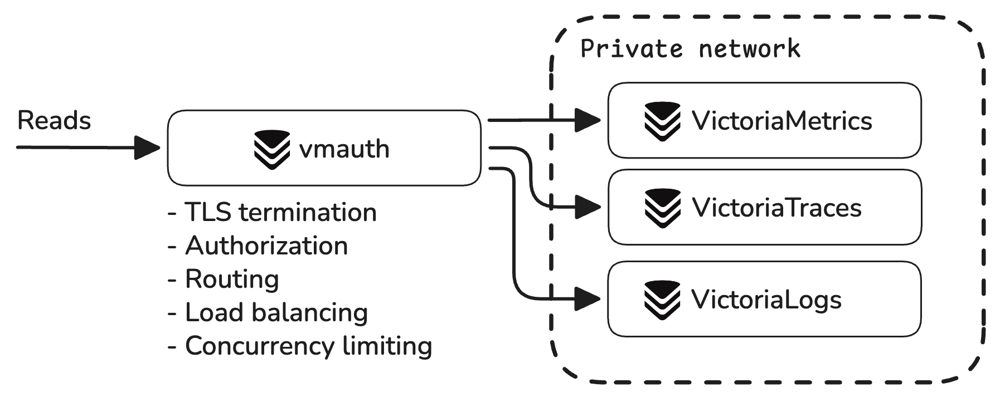

**Victoria Stack** is a unified observability platform built with three specialized databases that share the same
design philosophy, operational model, and ecosystem:

| Signal      | Product                                                              | Query language                                                                                                                                                                                                                                  | Horizontal scaling | Grafana | Multitenancy | Alerting |
|-------------|----------------------------------------------------------------------|-------------------------------------------------------------------------------------------------------------------------------------------------------------------------------------------------------------------------------------------------|--------------------|---------|--------------|----------|
| **Metrics** | [VictoriaMetrics](https://docs.victoriametrics.com/victoriametrics/) | [MetricsQL](https://docs.victoriametrics.com/metricsql/) (PromQL-compatible)                                                                                                                                                                    | Yes                | Yes     | Yes          | Yes      |
| **Logs**    | [VictoriaLogs](https://docs.victoriametrics.com/victorialogs/)       | [LogsQL](https://docs.victoriametrics.com/victorialogs/logsql/)                                                                                                                                                                                 | Yes                | Yes     | Yes          | Yes      |
| **Traces**  | [VictoriaTraces](https://docs.victoriametrics.com/victoriatraces/)   | [LogsQL](https://docs.victoriametrics.com/victorialogs/logsql/), [Jaeger API](https://docs.victoriametrics.com/victoriatraces/querying/#jaeger-http-api), [Tempo API](https://docs.victoriametrics.com/victoriatraces/querying/#tempo-http-api) | Yes                | Yes     | Yes          | Yes      |

> VictoriaMetrics software natively supports [OpenTelemetry](https://opentelemetry.io/) ingestion for **metrics**,
**logs**, and **traces** - see [these docs](https://docs.victoriametrics.com/opentelemetry/) for more details.


{width="700"}

Each product is Open Source, Apache2 licensed, production-ready and has its own extensive documentation.

## Why VictoriaStack?

VictoriaMetrics software is built with three core principles in mind: **simplicity, reliability, efficiency**.
Software that is easy to run and maintain, that fits well in home labs and can be reliably scaled to large production
environments. Each of the databases was heavily battle-tested in production environments.

These principles are achieved by focusing on what matters most for every signal. VictoriaMetrics is optimized
for time series workload, while VictoriaLogs design and architecture is optimized for log ingestion. 
VictoriaStack covers three main pillars of observability with fine-tuned solutions for each of the signals. 

## Quick Start

> If you're looking for a visual impression of the stack,
visit [Playgrounds page](https://docs.victoriametrics.com/playgrounds/)
to try publicly running installations of VictoriaStack, fed
with [OpenTelemetry Astronomy Shop demo](https://github.com/open-telemetry/opentelemetry-demo) data.

To run the stack locally with docker-compose, follow docs [here]():

```sh
git clone -b main https://github.com/VictoriaMetrics/VictoriaStack.git
make otel-single-up
```

> Note: docker-compose environment is very much simplified for demonstration purposes, it is **not intended for
production use**.
> The data it ingests is not representative of real-world data.

Once running, the following links will be available:

- [VictoriaMetrics UI - http://localhost:8428/](http://localhost:8428/vmui/?#/cardinality)
- [VictoriaLogs UI - http://localhost:9428](http://localhost:9428/select/vmui)
- [VictoriaTraces UI - http://localhost:10428](http://localhost:10428/select/vmui), but it is better to use [Grafana](http://localhost:3000)
- [Grafana - http://localhost:3000](http://localhost:3000/explore) with all 3 datasources preconfigured (login with admin:admin).

> More detailed Quick Start instructions for running in various environments, ingesting and querying data are available in
each product's documentation: [VictoriaMetrics Quick Start](https://docs.victoriametrics.com/victoriametrics/quick-start/),
[VictoriaLogs Quick Start](https://docs.victoriametrics.com/victorialogs/quick-start/), [VictoriaTraces Quick Start](https://docs.victoriametrics.com/victoriatraces/quick-start/).

Depending on your requirements, check the following docs:

* Ingestion: OpenTelemetry + other protocols
* Querying: Grafana, built-in UIs
* Correlations between signals
* Access control
* Alerting
* Horizontal scaling
* Multitenancy
* Security
* Backups & Restore
* Operations: monitoring, upgrades, scaling

## Ingestion

The easiest way to ingest data into VictoriaStack is to [integrate with OpenTelemetry collector](https://docs.victoriametrics.com/opentelemetry/),
as it can forward all three types of signals.

### OpenTelemetry

See the example of the OpenTelemetry collector configuration below:
```yaml
receivers:
  otlp:
    protocols:
      grpc:
        endpoint: 0.0.0.0:4317

exporters:
  otlp_http/vm-metrics: { metrics_endpoint: http://victoriametrics:8428/opentelemetry/v1/metrics }
  otlp_http/vm-logs:    { logs_endpoint: http://victorialogs:9428/insert/opentelemetry/v1/logs }
  otlp_http/vm-traces:  { traces_endpoint: http://victoriatraces:10428/insert/opentelemetry/v1/traces }

service:
  pipelines:
    logs:    { receivers: [ otlp ], exporters: [ otlp_http/vm-logs ] }
    traces:  { receivers: [ otlp ], exporters: [ otlp_http/vm-traces ] }
    metrics: { receivers: [ otlp ], exporters: [ otlp_http/vm-metrics ] }
```

In the example above, OpenTelemetry collector receives signals via gRPC protocol,
and forwards them to VictoriaStack via HTTP endpoints:
* `http://victoriametrics:8428/opentelemetry/v1/metrics` for metrics
* `http://victorialogs:9428/insert/opentelemetry/v1/logs` for logs
* `http://victoriatraces:10428/insert/opentelemetry/v1/traces` for traces

That's it! Generally, no additional configuration is required. However, there are some tweaks that can be applied
to each integration. See the following docs for more details:
* [VictoriaMetrics OpenTelemetry Setup](https://docs.victoriametrics.com/victoriametrics/integrations/opentelemetry/)
* [VictoriaLogs OpenTelemetry Setup](https://docs.victoriametrics.com/victorialogs/data-ingestion/opentelemetry/)
* [VictoriaTraces OpenTelemetry Setup](https://docs.victoriametrics.com/victoriatraces/data-ingestion/opentelemetry/)

> See integration examples OpenTelemetry Collector for [single-node]() and [clustered]() VictoriaStack.

### Integrations

Just like with [OpenTelemetry collector](), the easiest way to start ingesting data is to integrate with telemetry agents
that you already have in place. Do you use Prometheus or Grafana Alloy for metrics? Do you use Vector or Filebeat for logs?
All these agents can push directly to VictoriaStack:

* VictoriaMetrics: [Prometheus, Vector, Grafana Alloy, Telegraf...](https://docs.victoriametrics.com/victoriametrics/data-ingestion/) 
* VictoriaLogs: [Filebeat, Logstash, Vector, Promtail, Elasticsearch, Telegraf...](https://docs.victoriametrics.com/victorialogs/data-ingestion/) 

VictoriaTraces only supports integration with [OpenTelemetry](https://docs.victoriametrics.com/victoriatraces/data-ingestion/). 

### Ingestion protocols

Each database has its own list of supported ingestion protocols, most suitable for the type of the signal:

* VictoriaMetrics: [InfluxDB line, CSV, JSON...](https://docs.victoriametrics.com/victoriametrics/single-server-victoriametrics/#how-to-import-time-series-data)
* VictoriaLogs: [JSON, Loki, Journald](https://docs.victoriametrics.com/victorialogs/data-ingestion/#http-apis)

VictoriaTraces only supports integration with [OpenTelemetry](https://docs.victoriametrics.com/victoriatraces/data-ingestion/).

## UI integrations

### Grafana

Grafana is a great choice of a visualization tool that integrates with VictoriaStack.

The integration is happening via datasource plugins:
* VictoriaMetrics via [Prometheus](https://docs.victoriametrics.com/victoriametrics/integrations/grafana/#prometheus-datasource) or [VictoriaMetrics](https://docs.victoriametrics.com/victoriametrics/integrations/grafana/#victoriametrics-datasource) datasource plugins.
* VictoriaLogs via [VictoriaLogs datasource plugin](https://docs.victoriametrics.com/victorialogs/integrations/grafana/).
* VictoriaTraces via [Jaeger](https://docs.victoriametrics.com/victoriatraces/querying/grafana/#jaeger-datasource) or [Tempo](https://docs.victoriametrics.com/victoriatraces/querying/grafana/#grafana-tempo-datasource) datasource plugins.

> See [Grafana integration examples]() for single-node and clustered VictoriaStack.

Grafana provides queryless experience for exploring metrics, logs and traces using query builders within the datasource plugins.
It is the easiest way to get started reading data from VictoriaStack. But if you need advanced querying capabilities - see [querying docs]().

Grafana is also a great tool for building dashboards, running alerting rules and [correlating signals]().

### vmui

vmui is a UI frontend for VictoriaMetrics and VictoriaLogs. It is designed for ad-hoc exploration of metrics and logs,
using all the features of the corresponding database.

> VictoriaTraces doesn't have a dedicated UI yet, and it is recommended to use [Grafana](#) for exploring traces.

vmui is built-in into VictoriaMetrics and VictoriaLogs components:
* [VictoriaMetrics UI](https://docs.victoriametrics.com/victoriametrics/#vmui)
* [VictoriaLogs UI](https://docs.victoriametrics.com/victorialogs/querying/#web-ui)

> Have a quick look at vmui demo for [VictoriaMetrics](https://docs.victoriametrics.com/playgrounds/#victoriametrics-playground)
> and [VictoriaLogs](https://docs.victoriametrics.com/playgrounds/#victorialogs-playground) at our playgrounds.

We recommend using vmui for exploring metrics and logs when you value simplicity and speed. 
Use [Grafana]() or [Perses]() for dashboarding functionality.

### Perses

Similarly to [Grafana](#grafana), Perses integrates with VictoriaStack via datasource plugins:
* VictoriaMetrics integrates via [Prometheus datasource plugin](https://docs.victoriametrics.com/victoriametrics/integrations/perses/).
* VictoriaLogs integrates via [VictoriaLogs datasource plugin](https://docs.victoriametrics.com/victorialogs/integrations/perses/).
* VictoriaTraces integrates via [Jaeger](https://github.com/perses/plugins/tree/main/jaeger) or [Tempo](https://docs.victoriametrics.com/victoriatraces/querying/grafana/#grafana-tempo-datasource) datasource plugins.

If you need advanced querying capabilities - see [querying docs]().

## Querying

Metrics, logs and traces aren't alike. They are all different types of data with different querying patterns.
Expressing these specifics within one query language would inevitably result into losing practicality and flexibility.
That's why each database in the stack has its own query languages and integrations, tailored to the type of the signal.

### Querying metrics

VictoriaMetrics query language [MetricsQL](https://docs.victoriametrics.com/victoriametrics/metricsql/) is inspired
by [PromQL](https://prometheus.io/docs/prometheus/latest/querying/basics/). MetricsQL is backwards-compatible with PromQL,
so Grafana dashboards backed by Prometheus datasource or alerting/recording rules should work the same after switching 
from Prometheus to VictoriaMetrics. However, there are some [intentional differences](https://medium.com/@romanhavronenko/victoriametrics-promql-compliance-d4318203f51e)
between these two languages.

If you're not familiar with PromQL or MetricsQL, please read basic concepts of [MetricsQL](https://docs.victoriametrics.com/victoriametrics/keyconcepts/#metricsql).

Additionally, VictoriaMetrics implements [Graphite API](https://docs.victoriametrics.com/victoriametrics/integrations/graphite/#graphite-api-usage) 
for querying, which makes it a drop-in replacement for Graphite.

> For querying experience, take a quick look at [vmui](https://docs.victoriametrics.com/playgrounds/#victoriametrics-playground)
> and [Grafana](https://docs.victoriametrics.com/playgrounds/#grafana-playground) playgrounds.

See [migrating from PromQL to MetricsQL].

### Querying logs

VictoriaLogs query language [LogsQL](https://docs.victoriametrics.com/victorialogs/logsql/) is specifically designed for 
querying logs and provides the following features:
* Full-text search in any field.
* Ability to combine filters into arbitrary complex [logical filters](https://docs.victoriametrics.com/victorialogs/logsql/#logical-filter).
* Ability to extract structured fields from unstructured logs at query time via [transformations](https://docs.victoriametrics.com/victorialogs/logsql/#transformations).
* Ability to calculate various stats over the selected log entries via [stats](https://docs.victoriametrics.com/victorialogs/logsql/#stats-pipe).

> LogsQL provides excellent analytical capabilities and participates in the [ClickBench - a benchmark for analytical databases](https://github.com/ClickHouse/ClickBench/tree/main/victorialogs).

To get the basic concepts of LogsQL please read [LogsQL tutorial](https://docs.victoriametrics.com/victorialogs/logsql/#logsql-tutorial).

> For querying experience, take a quick look at [vmui](https://docs.victoriametrics.com/playgrounds/#victorialogs-playground)
> and [Grafana](https://docs.victoriametrics.com/playgrounds/#grafana-playground) playgrounds.

See also [SQL to LogsQL Tutorial](https://docs.victoriametrics.com/victorialogs/sql-to-logsql/) and
[How To Convert Loki Queries to VictoriaLogs Queries](https://docs.victoriametrics.com/victorialogs/logql-to-logsql/).

### Querying traces

VictoriaTraces query language is the same as for VictoriaLogs: [LogsQL](https://docs.victoriametrics.com/victorialogs/logsql/).
But most of the tracing experience comes from the User Interface capabilities where traces are filtered and visualized
in queryless fashion. This is why it is better to use [Grafana] or [Perses] for exploring traces.

However, querying capabilites with LogsQL are still available and are especially useful for [alerting with traces](https://docs.victoriametrics.com/victoriatraces/vmalert/).

## Correlations

Signals can be correlated together if they share the same list of attributes, so they can uniquely identify the
same system or event. The recommended user interface for correlations is Grafana thanks to its [correlation](https://grafana.com/docs/grafana/latest/administration/correlations/)
and derived fields features.

Depending on the Grafana datasource plugin there could be multiple correlations available:
1. Trace to logs, log to trace, log to metrics - see [correlations via VictoriaLogs plugin](https://docs.victoriametrics.com/victorialogs/integrations/grafana/#correlations).
1. Trace to metrics, metric to logs, metric to traces - see [correlations via VictoriaMetrics plugin](https://docs.victoriametrics.com/victoriametrics/integrations/grafana/datasource/#correlations).
1. Metrics to logs or traces correlations are possible via Prometheus datasource as well.
1. Plugins Tempo, Jaeger, and Zipkin can correlate with logs or metrics using [Trace to logs](https://grafana.com/docs/grafana/latest/explore/trace-integration/#trace-to-logs)
   and [Trace to metrics](https://grafana.com/docs/grafana/latest/visualizations/explore/trace-integration/#trace-to-metrics) feature.

Logs and Traces can be converted to metrics via [alerting and recording rules](), that opens further possibilities for correlation.

## Security

VictoriaMetrics, VictoriaLogs and VictoriaTraces components **must run inside a protected trusted network**.
Requests from the Internet must be properly **authorized before** being proxied to databases
via [vmauth](https://docs.victoriametrics.com/vmauth/)
or any other tool of your choice.



vmauth can perform the following actions:

- [Requests authorization](https://docs.victoriametrics.com/victoriametrics/vmauth/#authorization): Basic Auth, Bearer
  Token, JWT, etc.
- [Requests routing](https://docs.victoriametrics.com/victoriametrics/vmauth/#routing): by path, host, header, query
  args, etc.
- [TLS termination](https://docs.victoriametrics.com/victoriametrics/vmauth/#tls-termination-proxy)
- [Load balancing](https://docs.victoriametrics.com/victoriametrics/vmauth/#load-balancing)
- [IP filtering](https://docs.victoriametrics.com/victoriametrics/vmauth/#ip-filters)
- [mTLS protection](https://docs.victoriametrics.com/victoriametrics/vmauth/#mtls-protection)
- [Automatic issuing of TLS certificates](https://docs.victoriametrics.com/victoriametrics/vmauth/#automatic-issuing-of-tls-certificates)
- [Access logging](https://docs.victoriametrics.com/victoriametrics/vmauth/#access-log)

For example, the following vmauth configuration acts as a gateway between VictoriaStack components and users:

```yaml
# unauthorized_user doesn't expect any credentials to be provided
unauthorized_user:
  url_map:
    - src_paths: [ "/metrics/.*" ]
      url_prefix: "http://victoriametrics:8428/"
      drop_src_path_prefix_parts: 1

    - src_paths: [ "/logs/.*" ]
      url_prefix: "http://victorialogs:9428/"
      drop_src_path_prefix_parts: 1

    - src_paths: [ "/traces/.*" ]
      url_prefix: "http://victoriatraces:10428/"
      drop_src_path_prefix_parts: 1
```

Run vmauth with [TLS termination enabled](https://docs.victoriametrics.com/vmauth/index.html#tls-termination-proxy):

```sh
/path/to/vmauth -tls -tlsKeyFile=/path/to/tls_key_file -tlsCertFile=/path/to/tls_cert_file -httpListenAddr=0.0.0.0:443
```

Each service can be accessed via vmauth endpoint using its own URL:

- `https://vmauth/metrics/...` - to access VictoriaMetrics
- `https://vmauth/logs/...` - to access VictoriaLogs
- `https://vmauth/traces/...` - to access VictoriaTraces

See how to configure vmauth to authorize users and control access to the data in [these docs](#access-control).

### Sensitive endpoints

VictoriaStack components, including vmauth, expose sensitive endpoints for config hot reloading, metrics scraping,
profiling, etc.
It is recommended to protect these endpoints from the public or unauthorized access. Follow recommendations
per-component below:

- [vmauth](https://docs.victoriametrics.com/vmauth/#security)
- [VictoriaMetrics](https://docs.victoriametrics.com/victoriametrics/#general-security-recommendations)
-
VictoriaLogs [delete API](https://docs.victoriametrics.com/victorialogs/#how-to-delete-logs), [forced merge](https://docs.victoriametrics.com/victorialogs/#forced-merge), [forced flush](https://docs.victoriametrics.com/victorialogs/#forced-flush), [partitions management](https://docs.victoriametrics.com/victorialogs/#partitions-lifecycle)
- VictoriaTraces [sensitive APIs](https://docs.victoriametrics.com/victoriatraces/#security)

### Access control

By default, VictoriaMetrics, VictoriaLogs and VictoriaTraces databases do not limit access to their endpoints or to the
stored data. Instead, they provide various mechanisms for limiting access via [multitenancy]() or
enforcing [extra filters]().

It is recommended to use vmauth as a proxy between VictoriaStack components and users to enforce access control:
//- Route user requests

- Limit access to specific users
- Limit access to specific endpoints
- Limit access to specific tenants
- Enforce label filters

#### Authenticate users

The following vmauth configuration allows access to metrics and logs backends only to users with `admin` credentials:

```yaml
users:
  - username: admin
    password: "***"
    url_map:
      - src_paths: [ "/metrics/.*" ]
        url_prefix: "http://victoriametrics:8428/"
        # drop /metrics/ path prefix from the original request before proxying it to url_prefix.
        drop_src_path_prefix_parts: 1

      - src_paths: [ "/logs/.*" ]
        url_prefix: "http://victorialogs:9428/"
        drop_src_path_prefix_parts: 1
```

> See advanced authorization examples like JWT tokens in [vmauth docs](https://docs.victoriametrics.com/victoriametrics/vmauth/#authorization).
> See how to [Setup vmauth multitenant access with Grafana & OIDC](https://docs.victoriametrics.com/guides/grafana-vmauth-openid-configuration/).

#### Endpoints filtering

The `src_paths` in [vmauth config]() can be further modified to allow access only to specific paths:

```yaml
  - src_paths:
      - "/metrics/api/v1/query"
      - "/metrics/api/v1/query_range"
      - "/metrics/api/v1/series"
      - "/metrics/api/v1/labels"
      - "/metrics/api/v1/label/.+/values"
    url_prefix: "http://victoriametrics:8428/"
```

With this configuration, even authorized user will be able to normally query metrics and use Grafana, but won't be able
to access [sensitive endpoints]
like [/api/v1/admin/tsdb/delete_series](https://docs.victoriametrics.com/victoriametrics/#how-to-delete-time-series).

#### Tenants filtering

> For tenants filtering please first read [Multitenancy](https://docs.victoriametrics.com/victoriametrics/multitenancy.html) docs.

In vmauth configuration it is easy to route a username to the specific tenant:

```yaml
users:
  - username: team-dev
    password: "***"
    url_map:
      - src_paths: [ "/logs/.*" ]
        url_prefix: "http://victorialogs:9428/"
        drop_src_path_prefix_parts: 1
        headers:
          - "AccountID: 2"
          - "ProjectID: 4"

  - username: team-prod
    password: "***"
    url_map:
      - src_paths: [ "/logs/.*" ]
        url_prefix: "http://victorialogs:9428/"
        drop_src_path_prefix_parts: 1
        headers:
          - "AccountID: 1"
          - "ProjectID: 1"
```

In the config above, user `team-dev` will be able to access logs only from tenant `AccountID: 2; ProjectID: 4`,
and user `team-prod` will be able to access logs only from tenant `AccountID: 1; ProjectID: 1`.

See more details on how to configure multitenant access control in [VictoriaLogs]() and [VictoriaMetrics]().

#### IP filtering

The following vmauth configuration allows access to metrics and logs backends only to users with `admin` credentials:

```yaml
users:
  - username: admin
    password: "***"
    url_map:
      - src_paths: [ "/metrics/.*" ]
        url_prefix: "http://victoriametrics:8428/"
        # drop /metrics/ path prefix from the original request before proxying it to url_prefix.
        drop_src_path_prefix_parts: 1

      - src_paths: [ "/logs/.*" ]
        url_prefix: "http://victorialogs:9428/"
        drop_src_path_prefix_parts: 1
```

> See advanced authorization examples in [vmauth docs](https://docs.victoriametrics.com/victoriametrics/vmauth/#authorization).

The `src_paths` can be further modified to allow access only to specific paths:

```yaml
  - src_paths:
      - "/api/v1/query"
      - "/api/v1/query_range"
      - "/api/v1/series"
      - "/api/v1/labels"
      - "/api/v1/label/.+/values"
```

## Multitenancy

VictoriaMetrics, VictoriaLogs and VictoriaTraces databases support multitenancy.
A tenant is identified by (AccountID, ProjectID) pair, where AccountID and ProjectID are arbitrary 32-bit unsigned
integers.
The AccountID and ProjectID can be set during [data ingestion]() and [querying]() via AccountID and ProjectID request
headers.

> Please note, VictoriaMetrics supports multitenancy only in [cluster mode](https://docs.victoriametrics.com/victoriametrics/#multi-tenancy).
> The further details in this section will assume that VictoriaMetrics is running in cluster mode.

