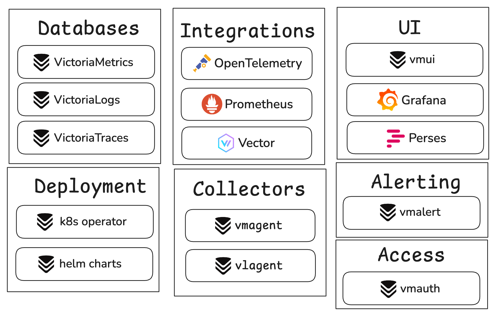

**VictoriaStack** is a unified observability platform built with three specialized databases that share the same
design philosophy, operational model, and ecosystem:

| Signal      | Product                                                              | Query language                                                                                                                                                                                                                                  | Horizontal scaling | Grafana | Multitenancy | Alerting |
|-------------|----------------------------------------------------------------------|-------------------------------------------------------------------------------------------------------------------------------------------------------------------------------------------------------------------------------------------------|--------------------|---------|--------------|----------|
| **Metrics** | [VictoriaMetrics](https://docs.victoriametrics.com/victoriametrics/) | [MetricsQL](https://docs.victoriametrics.com/metricsql/) (PromQL-compatible)                                                                                                                                                                    | Yes                | Yes     | Yes          | Yes      |
| **Logs**    | [VictoriaLogs](https://docs.victoriametrics.com/victorialogs/)       | [LogsQL](https://docs.victoriametrics.com/victorialogs/logsql/)                                                                                                                                                                                 | Yes                | Yes     | Yes          | Yes      |
| **Traces**  | [VictoriaTraces](https://docs.victoriametrics.com/victoriatraces/)   | [LogsQL](https://docs.victoriametrics.com/victorialogs/logsql/), [Jaeger API](https://docs.victoriametrics.com/victoriatraces/querying/#jaeger-http-api), [Tempo API](https://docs.victoriametrics.com/victoriatraces/querying/#tempo-http-api) | Yes                | Yes     | Yes          | Yes      |

> VictoriaMetrics software natively supports [OpenTelemetry](https://opentelemetry.io/) ingestion for **metrics**,
**logs**, and **traces** - see [these docs](https://docs.victoriametrics.com/opentelemetry/) for more details.



{width="700"}

Each product is Open Source, Apache-2.0 licensed, production-ready, and has its own extensive documentation.

## Why VictoriaStack?

VictoriaMetrics software is built on three core principles: **simplicity, reliability, and efficiency**.
Software that is easy to run and maintain, that fits well in home labs and can be reliably scaled to large production
environments. Each of the databases was heavily battle-tested in production environments.

These principles are achieved by focusing on what matters most for every signal. VictoriaMetrics is optimized
for time series workload, while VictoriaLogs design and architecture are optimized for log ingestion. 
VictoriaStack covers three main pillars of observability with fine-tuned solutions for each of the signals. 

//TODO: and some more motivation on choosing why

## Quick Start

> If you're looking for a visual impression of the stack,
visit [Playgrounds page](https://docs.victoriametrics.com/playgrounds/)
and try publicly running installations of VictoriaStack, fed
with [OpenTelemetry Astronomy Shop demo](https://github.com/open-telemetry/opentelemetry-demo) data.

To run the stack locally with Docker Compose, follow the docs [here]():

```sh
git clone https://github.com/VictoriaMetrics/VictoriaStack.git
make otel-single-up
```

> Note: the Docker Compose environment is very much simplified for demonstration purposes; it is **not intended for
production use**.
> The data it ingests is not representative of real-world data.

Once running, the following links will be available:

- [VictoriaMetrics UI - http://localhost:8428/](http://localhost:8428/vmui/?#/cardinality)
- [VictoriaLogs UI - http://localhost:9428](http://localhost:9428/select/vmui)
- [VictoriaTraces UI - http://localhost:10428](http://localhost:10428/select/vmui), but it is better to use [Grafana](http://localhost:3000)
- [Grafana - http://localhost:3000](http://localhost:3000/explore) with preconfigured datasources (_login with admin:admin_).

> More detailed Quick Start instructions for running in various environments, ingesting and querying data are available in
each product's documentation: 
> - [VictoriaMetrics Quick Start](https://docs.victoriametrics.com/victoriametrics/quick-start/)
> - [VictoriaLogs Quick Start](https://docs.victoriametrics.com/victorialogs/quick-start/)
> - [VictoriaTraces Quick Start](https://docs.victoriametrics.com/victoriatraces/quick-start/)

//TODO: add screenshots here

Depending on your requirements, check the following docs:

// TODO: add links to docs

* Ingestion: OpenTelemetry + other protocols
* Querying: Grafana, built-in UIs
* Correlations between signals
* Access control
* Alerting
* Horizontal scaling
* Multitenancy
* Security
* Backups & Restore
* Operations: monitoring, upgrades, scaling


