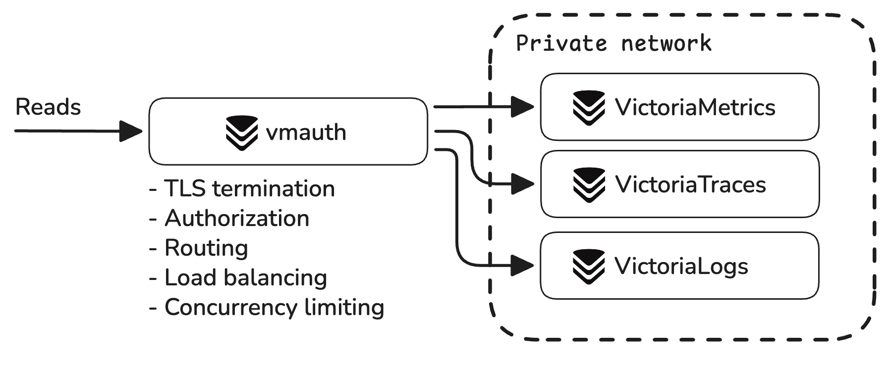

VictoriaMetrics, VictoriaLogs, and VictoriaTraces components **must run inside a protected trusted network**.
For internet-facing deployments, use [vmauth](https://docs.victoriametrics.com/vmauth/) or another authentication proxy to authenticate requests before they reach the databases.



vmauth can perform the following actions:

- [Requests authorization](https://docs.victoriametrics.com/victoriametrics/vmauth/#authorization): Basic Auth, Bearer
  Token, JWT, etc.
- [Requests routing](https://docs.victoriametrics.com/victoriametrics/vmauth/#routing): by tenant, path, host, header,
  query args, etc.
- [TLS termination](https://docs.victoriametrics.com/victoriametrics/vmauth/#tls-termination-proxy)
- [Load balancing](https://docs.victoriametrics.com/victoriametrics/vmauth/#load-balancing)
- [IP filtering](https://docs.victoriametrics.com/victoriametrics/vmauth/#ip-filters)
- [mTLS protection](https://docs.victoriametrics.com/victoriametrics/vmauth/#mtls-protection)
- [Automatic issuing of TLS certificates](https://docs.victoriametrics.com/victoriametrics/vmauth/#automatic-issuing-of-tls-certificates)
- [Access logging](https://docs.victoriametrics.com/victoriametrics/vmauth/#access-log)

For example, the following vmauth configuration acts as a gateway between VictoriaStack components and users:

```yaml
# unauthorized_user doesn't expect any credentials to be provided
unauthorized_user:
  url_map:
    - src_paths: [ "/metrics/.*" ]
      url_prefix: "http://victoriametrics:8428/"
      drop_src_path_prefix_parts: 1

    - src_paths: [ "/logs/.*" ]
      url_prefix: "http://victorialogs:9428/"
      drop_src_path_prefix_parts: 1

    - src_paths: [ "/traces/.*" ]
      url_prefix: "http://victoriatraces:10428/"
      drop_src_path_prefix_parts: 1
```

With the configuration above, each service can be accessed via the vmauth endpoint using its own URL:

- `https://vmauth/metrics/...` - to access VictoriaMetrics
- `https://vmauth/logs/...` - to access VictoriaLogs
- `https://vmauth/traces/...` - to access VictoriaTraces

See how to configure vmauth to authorize users and control access to the data in [these docs](#access-control).

### Access control

By default, VictoriaMetrics, VictoriaLogs, and VictoriaTraces databases do not limit access to their endpoints or to the
stored data. Instead, they provide various mechanisms for limiting access to the data via [multitenancy]() or
enforcing [extra filters](). 

It is recommended to use vmauth as a proxy between VictoriaStack components and users to enforce access control:
//- Route user requests

- Limit access to specific users
- Limit access to specific endpoints
- Limit access to specific tenants
- Enforce label filters

> See also how to limit access to the [Sensitive Endpoints](http://localhost:1313/victoria-stack/security/#sensitive-endpoints).

#### Authenticate users

The following vmauth configuration allows access to metrics and logs backends only to users with `admin` credentials:

```yaml
users:
  - username: admin
    password: "***"
    url_map:
      - src_paths: [ "/metrics/.*" ]
        url_prefix: "http://victoriametrics:8428/"
        # drop /metrics/ path prefix from the original request before proxying it to url_prefix.
        drop_src_path_prefix_parts: 1

      - src_paths: [ "/logs/.*" ]
        url_prefix: "http://victorialogs:9428/"
        drop_src_path_prefix_parts: 1
```

> See advanced authorization examples like [JWT tokens](https://docs.victoriametrics.com/victoriametrics/vmauth/#authorization)
> or how to [Setup multitenant access with Grafana & OIDC](https://docs.victoriametrics.com/guides/grafana-vmauth-openid-configuration/).

#### Tenants filtering

For tenant filtering, please read the [Multitenancy]() docs first.

In vmauth configuration, it is easy to route a username to the specific tenant:

```yaml
users:
  - username: team-dev
    password: "***"
    url_map:
      - src_paths: [ "/logs/.*" ]
        url_prefix: "http://victorialogs:9428/"
        drop_src_path_prefix_parts: 1
        headers:
          - "AccountID: 2"
          - "ProjectID: 4"

  - username: team-prod
    password: "***"
    url_map:
      - src_paths: [ "/logs/.*" ]
        url_prefix: "http://victorialogs:9428/"
        drop_src_path_prefix_parts: 1
        headers:
          - "AccountID: 1"
          - "ProjectID: 1"
      - src_paths: [ "/traces/.*" ]
        url_prefix: "http://victoriatraces:10428/"
        drop_src_path_prefix_parts: 1
        headers:
          - "AccountID: 1"
          - "ProjectID: 1"
```

In the config above, user `team-dev` will be able to access logs only from tenant `AccountID: 2; ProjectID: 4`,
and user `team-prod` will be able to access logs and traces only from tenant `AccountID: 1; ProjectID: 1`.

See more details on how to configure multitenant access control in [VictoriaLogs]() and [VictoriaMetrics]().

#### Endpoints filtering

The `src_paths` in [vmauth config]() can be further modified to allow access only to specific paths:

```yaml
  - src_paths:
      - "/metrics/api/v1/query"
      - "/metrics/api/v1/query_range"
      - "/metrics/api/v1/series"
      - "/metrics/api/v1/labels"
      - "/metrics/api/v1/label/.+/values"
    url_prefix: "http://victoriametrics:8428/"
```

With this configuration, even authorized users will be able to normally query metrics and use Grafana, but won't be able
to access [Sensitive Endpoints](http://localhost:1313/victoria-stack/security/#sensitive-endpoints)
like [/api/v1/admin/tsdb/delete_series](https://docs.victoriametrics.com/victoriametrics/#how-to-delete-time-series).

#### IP filtering

The following vmauth configuration allows access to metrics and logs backends only to users with `admin` credentials:

```yaml
users:
  - username: admin
    password: "***"
    url_map:
      - src_paths: [ "/metrics/.*" ]
        url_prefix: "http://victoriametrics:8428/"
        # drop /metrics/ path prefix from the original request before proxying it to url_prefix.
        drop_src_path_prefix_parts: 1

      - src_paths: [ "/logs/.*" ]
        url_prefix: "http://victorialogs:9428/"
        drop_src_path_prefix_parts: 1
```

> See advanced authorization examples in [vmauth docs](https://docs.victoriametrics.com/victoriametrics/vmauth/#authorization).

### Sensitive endpoints

VictoriaStack components, including vmauth, expose sensitive endpoints for config hot reloading, metrics scraping,
profiling, etc.
It is recommended to protect these endpoints from public or unauthorized access. Follow recommendations
per component below:

- [vmauth security](https://docs.victoriametrics.com/vmauth/#security)
- [VictoriaMetrics security](https://docs.victoriametrics.com/victoriametrics/#general-security-recommendations)
- [VictoriaLogs system endpoints](https://docs.victoriametrics.com/victorialogs/security-and-lb/#system-endpoints)
- [VictoriaTraces security](https://docs.victoriametrics.com/victoriatraces/#security)
- [vmalert security](https://docs.victoriametrics.com/vmalert/#security)


