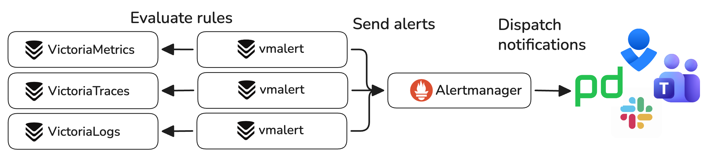

Alerting constantly evaluates rules and sends notifications if certain conditions are met. It helps to get notified
if service is down, HTTP request rate increases, log entries contain errors, traces taking too long.

In VictoriaStack, [vmalert](https://docs.victoriametrics.com/vmalert/) components acts as an alerting engine and
integrates with [Alertmanager](https://github.com/prometheus/alertmanager) - a tool for dispatching alerting notifications
to various destinations like [email, Slack, PagerDuty, MS Teams, etc](https://prometheus.io/docs/alerting/latest/integrations/#available-integrations).



## Quick Start

There are following things required to start using alerting:
1. A list of [rules](#rules) to execute.
2. A datasource URL to execute the rules against.
3. Alertmanager service URL to send notifications to.

> TODO: Add a link to docker-compose example

vmalert is a single binary service that can be started with the following command:
```sh
./path/to/vmalert -rule=alert.rules \              # Path to the file with rules configuration. Supports wildcard and HTTP URL (S3/GCS are available in Enterprise).
    -datasource.url=http://victoriametrics:8428 \  # Datasource URL to query for rules evaluation
    -notifier.url=http://alertmanager:9093 \       # AlertManager URL
```

> See more detailed documentation in [vmalert Quick Start docs](https://docs.victoriametrics.com/vmalert/#quickstart).

With configuration above, vmalert will periodically evaluate rules read from `alert.rules` file by querying specified
`-datasource.url` and sending notifications to `-notifier.url` if conditions are met.

The key features of vmalert are:
* Supports Prometheus [alerting rules definition format](https://prometheus.io/docs/prometheus/latest/configuration/alerting_rules/#defining-alerting-rules),
  making it easier to migrate from Prometheus stack
* Supports [recording rules](http://localhost:1313/vmalert/#recording-rules), aka converting query results into metrics
* [Hot reload](https://docs.victoriametrics.com//victoriametrics/vmalert/#hot-config-reload) of rules configuration
* Keeps the alert [state on restarts](https://docs.victoriametrics.com/#alerts-state-on-restarts)
* Supports recording and alerting rules backfilling (aka `replay`). See [these docs](https://docs.victoriametrics.com/#rules-backfilling);

## Rules

vmalert is configured with [rules in yaml format](https://docs.victoriametrics.com/vmalert.html#groups) that it can
fetch from the local file system, remote URL, or object storage. Rules expressions are set as regular query expressions
in the corresponding language. For example, the following alerting rule for VictoriaLogs triggers if the number of `error`
or `warn` logs on a single pod in `env=prod` exceeds 10 during the last 5 minutes:
```yaml
groups:
  - name: ServiceLog
    type: vlogs # The type is set to query VictoriaLogs
    interval: 5m
    rules:
      - alert: HasMoreThan10ErrorLogs
        expr: '{env=prod} status:in(error,warn) | stats by (k8s.pod.name) count() as error_logs | filter error_logs:>10'
        annotations:
          description: 'Too big number of errors and warnings on pod {{ index .Labels "k8s.pod.name" }} during the last 5 minutes: {{$value}}'
```

> It is recommended to use a separate vmalert instance for each signal type. This simplifies rules configuration and
> isolates pipelines for different signal types. However, it is still possible to use a single vmalert instance for
> [multiple signal types](https://docs.victoriametrics.com/victorialogs/vmalert/#how-to-use-one-vmalert-for-victorialogs-and-victoriametrics-rules-at-the-same-time).

See production-ready examples of alerting rules for VictoriaMetrics monitoring [here](https://github.com/VictoriaMetrics/VictoriaMetrics/tree/master/deployment/docker/rules).

## Datasource

vmalert allows specifying only one datasource URL for rules evaluation.

## Alertmanager

## High Availability