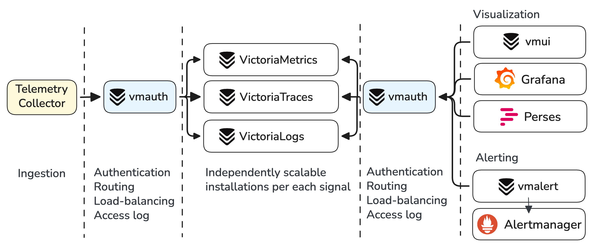
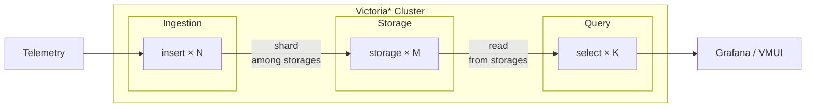
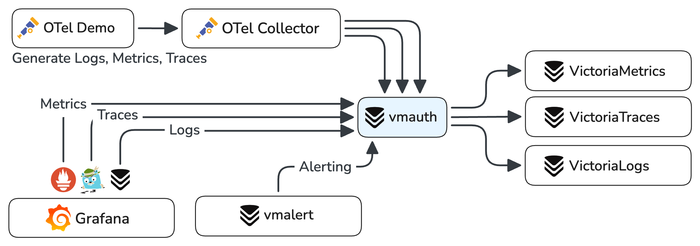
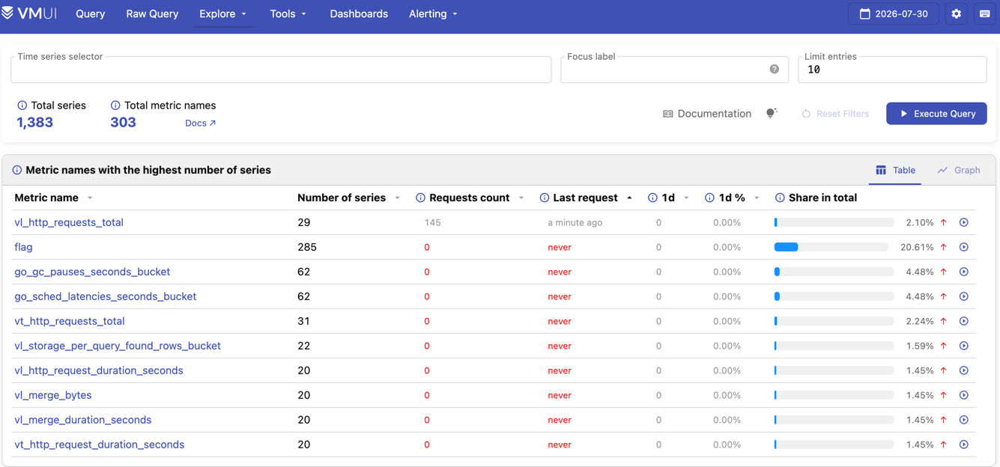
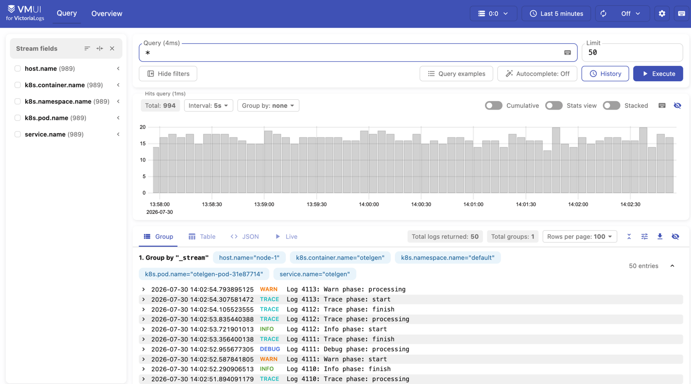
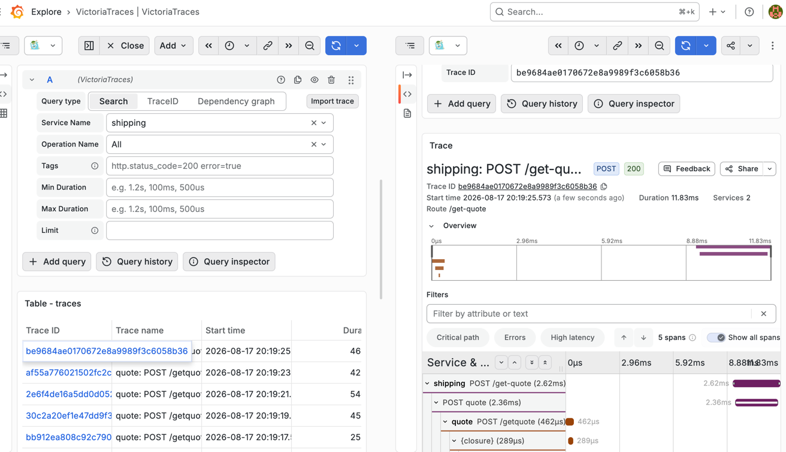
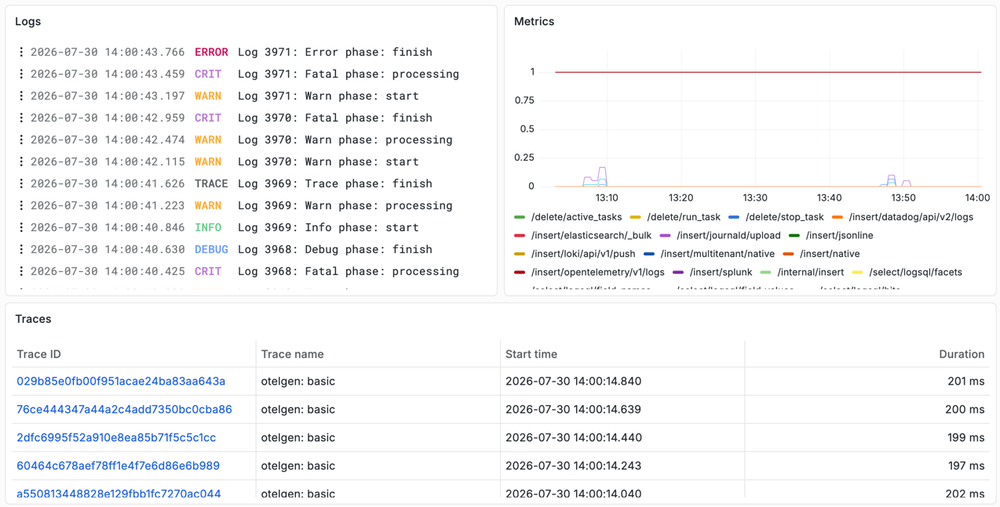
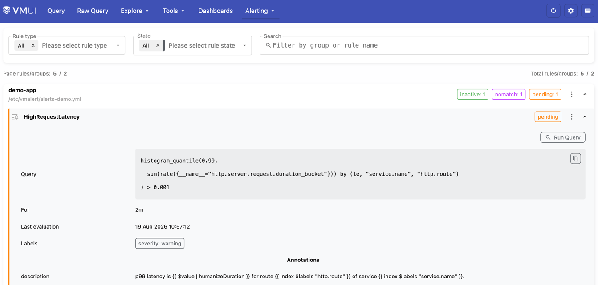
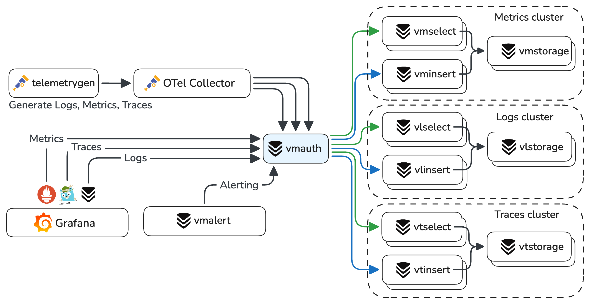

**VictoriaStack** is an observability stack for metrics, logs, and traces.

| Signal      | Product                                                              | Query language                                                                                                                                                                                                                                  | Scalability                                                                                                                                                    |
|-------------|----------------------------------------------------------------------|-------------------------------------------------------------------------------------------------------------------------------------------------------------------------------------------------------------------------------------------------|----------------------------------------------------------------------------------------------------------------------------------------------------------------|
| **Metrics** | [VictoriaMetrics](https://docs.victoriametrics.com/victoriametrics/) | [MetricsQL](https://docs.victoriametrics.com/metricsql/) (PromQL-compatible)                                                                                                                                                                    | Billions of [active time series](https://docs.victoriametrics.com/victoriametrics/faq/#what-is-an-active-time-series), Millions of samples ingested per second |
| **Logs**    | [VictoriaLogs](https://docs.victoriametrics.com/victorialogs/)       | [LogsQL](https://docs.victoriametrics.com/victorialogs/logsql/)                                                                                                                                                                                 | Hundreds of TBs a day, with avg post-compression ratio of x15                                                                                                  |
| **Traces**  | [VictoriaTraces](https://docs.victoriametrics.com/victoriatraces/)   | [LogsQL](https://docs.victoriametrics.com/victorialogs/logsql/), [Jaeger API](https://docs.victoriametrics.com/victoriatraces/querying/#jaeger-http-api), [Tempo API](https://docs.victoriametrics.com/victoriatraces/querying/#tempo-http-api) | Billions of spans per day with avg post-compression ratio of x15                                                                                               |

<br>

Each database is a separate application, specialized for its own signal. All three share the same design philosophy,
operational model, and ecosystem.

The stack has no bundled all-in-one UI. Use [Grafana](http://localhost:1313/victoriastack/ui/#grafana)
or [Perses](http://localhost:1313/victoriastack/ui/#perses) to build dashboards and correlate all three signals.
Every database also ships with a built-in [vmui](http://localhost:1313/victoriastack/ui/#vmui) for ad-hoc exploration.

// TODO: READINESS: visum to become all-in-one

## Why VictoriaStack?

VictoriaStack is built on three core principles: **simplicity, reliability, and efficiency**.
It is easy to run and maintain. It fits well in home labs and scales reliably to large production environments,
and each database is battle-tested in production.

The stack focuses on what matters most for each signal. VictoriaMetrics is optimized for time series workloads,
while VictoriaLogs is optimized for wide events (logs and traces). Separate storage backends keep each database
simple, efficient, independent, and fine-tuned for its signal. No schema or index design is required: push the data
and VictoriaStack takes care of the rest.

VictoriaStack [accepts the most popular ingestion protocols](http://localhost:1313/victoriastack/ingestion/):

* **Metrics**: Prometheus `remote_write`, OpenTelemetry, InfluxDB line, Graphite, DataDog, OpenTSDB.
* **Logs**: Elasticsearch bulk, Loki JSON, syslog, journald, DataDog, OpenTelemetry.
* **Traces**: OpenTelemetry.

VictoriaMetrics serves a Prometheus-compatible API, and VictoriaTraces serves Jaeger- and Tempo-compatible APIs.
Existing Grafana dashboards, alerting rules, and recording rules keep working.

The stack supports multitenancy, alerting, out-of-order backfilling, efficient compression, and sane defaults
that simplify the setup.

Choose VictoriaStack to **own your observability** and build a **reliable**,
**cost-efficient multitenant platform** ready for future growth.

> Already running another observability stack? See [Comparisons](http://localhost:1313/victoriastack/comparisons/)
> to learn how VictoriaStack differs from Grafana LGTM, ClickStack, SigNoz, Elastic Stack, and Prometheus+Thanos,
> and when each alternative is the better fit.

## Architecture

VictoriaStack runs the three databases as independent installations,
with [vmauth](http://localhost:1313/victoriametrics/vmauth) as a single entrypoint that routes and load balances
requests:


{width="700"}

All three databases share the same component model. Each of them runs either as a single binary or as a cluster
of three component types:



* stateless **insert**: processes incoming data and shards it among storages;
* stateful **storage**: efficiently stores and manages data;
* stateless **select**: processes incoming read queries and returns results.

**insert** and **select** components need to know only about **storages**. They don't know about each other, and
**storages** don't know about **inserts**, **selects**, or other **storages**. This design allows flexible topologies
with sub-clusters, where **inserts** or **selects** connect to all or to a subset of **storages**.

Cluster architecture doesn't require any additional services: no extra caches, databases, or compactors. For stateless
components we recommend [vmauth as a load balancer](http://localhost:1313/victoriametrics/vmauth/#load-balancing),
or any other load balancer of your choice.

## What's in the stack

| What                                                                                    | How                                                                                                                                                                                                                                                                                                                                                            |
|-----------------------------------------------------------------------------------------|----------------------------------------------------------------------------------------------------------------------------------------------------------------------------------------------------------------------------------------------------------------------------------------------------------------------------------------------------------------|
| **[Deployment](http://localhost:1313/victoriastack/deployment/)**                       | [Kubernetes Operator](http://localhost:1313/victoriastack/deployment/#victoriametrics-operator), [Helm charts](http://localhost:1313/victoriastack/deployment/#helm-charts), [Binaries](http://localhost:1313/victoriastack/deployment/#binary)                                                                                                                |
| **[Ingestion integrations](http://localhost:1313/victoriastack/ingestion/)**            | [OpenTelemetry](http://localhost:1313/victoriastack/ingestion/#opentelemetry), [Vector, Grafana Alloy, 10+ additional integrations](http://localhost:1313/victoriastack/ingestion/#agents-and-protocols)                                                                                                                                                       |
| **[Native ingestion](http://localhost:1313/victoriastack/ingestion/#native-ingestion)** | **High throughput, reliable on-disk buffering, replication, traffic compression** via [vmagent](http://localhost:1313/victoriastack/ingestion/#vmagent) for metrics, [vlagent](http://localhost:1313/victoriastack/ingestion/#vlagent) for logs, [vtagent](http://localhost:1313/victoriastack/ingestion/#vtagent) for traces.                                 |
| **[Access control](http://localhost:1313/victoriastack/access-control/)**               | [vmauth](https://docs.victoriametrics.com/victoriametrics/vmauth/) for [user's authentication](http://localhost:1313/victoriastack/access-control/#authentication), [requests routing](http://localhost:1313/victoriastack/access-control/#routing-and-load-balancing), [per-tenant access](http://localhost:1313/victoriastack/access-control/#multitenancy). |
| **[Visualization](http://localhost:1313/victoriastack/ui/)**                            | [Grafana](http://localhost:1313/victoriastack/ui/#grafana) and [Perses](http://localhost:1313/victoriastack/ui/#perses) for unified observability and dashboarding. Built-in [vmui](http://localhost:1313/victoriastack/ui/#vmui) for ad-hoc exploration.                                                                                                      |
| **[Alerting](http://localhost:1313/victoriastack/alerting/)**                           | vmalert integrated with [Alertmanager](http://localhost:1313/victoriastack/alerting/#alertmanager) for rules evaluation and dispatching notifications                                                                                                                                                                                                          |
| **[Anomaly detection](/victoriastack/anomaly-detection/)**                              | [vmanomaly](/anomaly-detection/) learns expected data behavior and writes a [unified anomaly score](/anomaly-detection/faq/#what-is-anomaly-score) to VictoriaMetrics for contextual alerting and investigation.                                                                                                                                               |
| **Extended support via [Enterprise](http://localhost:1313/victoriastack/enterprise)**   | [Long Term Support(LTS) releases](http://localhost:1313/victoriastack/enterprise/#long-term-support-releases), consulting, architectural guidance, solutions engineering.                                                                                                                                                                                      |

## Quick Start

> If you're looking for a visual impression of the VictoriaStack,
> visit [Playgrounds page](https://docs.victoriametrics.com/playgrounds/)
> and try publicly running installations fed
> with [OpenTelemetry Astronomy Shop demo](https://github.com/open-telemetry/opentelemetry-demo) data.

You can deploy VictoriaStack as binaries on bare metal, as docker containers, or in Kubernetes via Helm charts and the
operator. See the [deployment docs](http://localhost:1313/victoriastack/deployment/) for details.

The sections below deploy VictoriaStack with docker compose, the easiest way to run and experiment with it locally.
You will need [Docker](https://docs.docker.com/get-started/get-docker/)
with [Compose v2](https://docs.docker.com/compose/) and `git`.

### Single-node version

The simplest setup runs VictoriaMetrics, VictoriaLogs, and VictoriaTraces as single-node deployments.
Start it locally with the [otel-single-node.yml](https://github.com/VictoriaMetrics/VictoriaStack/blob/main/deployment/otel-single-node.yml)
docker compose file:

```sh
git clone https://github.com/VictoriaMetrics/VictoriaStack.git && cd VictoriaStack
make otel-single-up
```

> Note: this Docker Compose environment is simplified for demonstration purposes.
> It is **not intended for production use**.

The command starts:

- a minimized version of [OpenTelemetry Demo](https://github.com/VictoriaMetrics/VictoriaStack/blob/main/deployment/otel-demo-mini.yml) with an OpenTelemetry collector;
- single-node VictoriaMetrics, VictoriaLogs, and VictoriaTraces for storing and querying signals;
- vmalert for evaluating alerting rules;
- Grafana for visualizing signals;
- vmauth as a single entrypoint that authorizes and routes requests to the appropriate component.



After the demo was running for a few minutes, the following links are available:

- Visit [VictoriaMetrics UI - http://localhost:8427/metrics/select/vmui](http://localhost:8427/metrics/select/vmui/?#/cardinality)
  to explore the stored metrics or [run a query to plot charts](http://localhost:8427/metrics/select/vmui/#/?g0.range_input=15m&g0.end_input=2026-08-17T18%3A14%3A42&g0.relative_time=last_15_minutes&g0.tab=0&g0.expr=sum%28rate%28%7B__name__%3D%22http.server.request.body.size_bucket%22%7D%5B5m%5D%29%29&g0.step_input=3s):
  
  {width="500"}

- Visit [VictoriaLogs UI - http://localhost:8427/logs/select/vmui](http://localhost:8427/logs/select/vmui) to see
  recently ingested logs or [run a query to plot charts](http://localhost:8427/logs/select/vmui/?#/?g0.range_input=15m&g0.relative_time=last_15_minutes&step=5s&query=*+%7C+by%28service.name%29+count%28%29&group_hits=service.name&g0.end_input=2026-08-17T18%3A17%3A27.768Z):
  
  {width="500"}

- [VictoriaTraces UI - http://localhost:8427/traces/select/vmui](http://localhost:8427/traces/select/vmui), but it is
  better to use Grafana's Explore [via Jaeger](http://localhost:3000/explore?schemaVersion=1&panes=%7B%220ut%22:%7B%22datasource%22:%22victoriatraces-jaeger-ds%22,%22queries%22:%5B%7B%22refId%22:%22A%22,%22datasource%22:%7B%22type%22:%22jaeger%22,%22uid%22:%22victoriatraces-jaeger-ds%22%7D,%22queryType%22:%22search%22,%22service%22:%22shipping%22%7D%5D,%22range%22:%7B%22from%22:%22now-1h%22,%22to%22:%22now%22%7D,%22compact%22:false%7D%7D&orgId=1)
  or [Tempo](http://localhost:3000/explore?schemaVersion=1&panes=%7B%220ut%22:%7B%22datasource%22:%22victoriatraces-tempo-ds%22,%22queries%22:%5B%7B%22refId%22:%22A%22,%22datasource%22:%7B%22type%22:%22tempo%22,%22uid%22:%22victoriatraces-tempo-ds%22%7D,%22queryType%22:%22traceqlSearch%22,%22limit%22:20,%22tableType%22:%22traces%22,%22metricsQueryType%22:%22range%22,%22serviceMapUseNativeHistograms%22:false,%22filters%22:%5B%7B%22id%22:%2219638448%22,%22operator%22:%22%3D%22,%22scope%22:%22span%22%7D%5D%7D%5D,%22range%22:%7B%22from%22:%22now-1h%22,%22to%22:%22now%22%7D,%22compact%22:false%7D%7D&orgId=1)
  (_login with admin:admin_):
  
  {width="500"}

- [Grafana - http://localhost:3000](http://localhost:3000/explore) with preconfigured datasources
  and a simple demo dashboard (_login with admin:admin_):
  
  {width="500"}

The demo will spawn two vmalert instances:
1. To run alerting rules [alerts-demo.yml](https://github.com/VictoriaMetrics/VictoriaStack/blob/main/deployment/rules/alerts-demo.yml)
   on metrics generated by OpenTelemery demo and stored in VictoriaMetrics. 
   Check rules state at [VictoriaMetrics alerting UI](http://localhost:8427/metrics/select/vmui/#/rules) or in [Grafana alerting](http://localhost:3000/alerting/list).
   
   {width="500"}

2. To run recording rules [logs-to-metrics.yml](https://github.com/VictoriaMetrics/VictoriaStack/blob/main/deployment/rules/logs-to-metrics.yml)
   converting logs from VictoriaLogs to metrics and writing them to VictoriaMetrics. Check results by querying
   [service_name:logs_count:1m](http://localhost:8427/metrics/select/vmui/#/?g0.range_input=30m&g0.end_input=2026-08-19T09%3A18%3A20&g0.relative_time=last_30_minutes&g0.tab=0&g0.expr=service_name%3Alogs_count%3A1m)
   or [severity_text:quotes_count:1m](http://localhost:8427/metrics/select/vmui/#/?g0.range_input=30m&g0.end_input=2026-08-19T09%3A18%3A53&g0.relative_time=last_30_minutes&g0.tab=0&g0.expr=severity_text%3Aquotes_count%3A1m)
   metric names in VictoriaMetrics UI.

The OpenTelemery demo will keep pushing telemetry signals to the stack through the OpenTelemetry collector, and vmalert 
will keep evaluating rules. To stop the stack, run:

```sh
make otel-single-down
```

The single-node version is the simplest way to start experimenting and to learn how the components fit together.
To scale the stack horizontally, see the [clustered version](#clustered-version).

### Clustered version

Run the stack locally with [otel-cluster.yml](https://github.com/VictoriaMetrics/VictoriaStack/blob/main/deployment/otel-cluster.yml)
docker compose file:

```sh
git clone https://github.com/VictoriaMetrics/VictoriaStack.git && cd VictoriaStack
make otel-cluster-up
```

It runs the same setup as the [single-node version](#single-node-version), but each database runs as a cluster of three
independently scalable components: insert, select, and storage.
In this topology, vmauth also balances requests among insert and select components.



vmauth routes the requests, so the UI links stay
the [same as in the single-node version](#single-node-version).

The generator keeps pushing telemetry signals to the stack through the OpenTelemetry collector, and vmalert keeps
evaluating alerting rules. To stop the stack, run:

```sh
make otel-cluster-down
```

## Scaling

VictoriaMetrics, VictoriaLogs, and VictoriaTraces are highly scalable and simple to operate:

- one VictoriaMetrics cluster can handle thousands of tenants, billions of time series, millions of samples per second,
  thousands of read requests per second;
- one VictoriaLogs cluster can handle thousands of tenants, hundreds of terabytes of logs per day,
  thousands of read requests per second;
- one VictoriaTraces cluster can handle thousands of tenants, billions of spans per day.

[**inserts**, **selects** and **storages**](#architecture) can be scaled independently:

* add more **insert** replicas to increase ingestion throughput;
* add more **select** replicas to increase query throughput;
* add more **storage** shards to increase overall performance and overcome hardware limits like CPU, memory, IO,
  or filesystem capacity.

## Retention and storage

All three databases store data on the local filesystem and delete it automatically once it falls outside the
configured retention:

| Database                                                                                                     | Default retention | How to configure                                                                                               |
|--------------------------------------------------------------------------------------------------------------|-------------------|----------------------------------------------------------------------------------------------------------------|
| [VictoriaMetrics](https://docs.victoriametrics.com/victoriametrics/single-server-victoriametrics/#retention) | 1 month           | `-retentionPeriod`, from `1d` up to years                                                                      |
| [VictoriaLogs](https://docs.victoriametrics.com/victorialogs/#retention)                                     | 7 days            | `-retentionPeriod`, or a disk limit via `-retention.maxDiskSpaceUsageBytes` / `-retention.maxDiskUsagePercent` |
| [VictoriaTraces](https://docs.victoriametrics.com/victoriatraces/#retention)                                 | 7 days            | `-retentionPeriod`, or a disk limit via `-retention.maxDiskSpaceUsageBytes` / `-retention.maxDiskUsagePercent` |

<br>

Disk usage depends on your data and on how well it compresses. Estimate it with the capacity planning docs
for [VictoriaMetrics](https://docs.victoriametrics.com/victoriametrics/single-server-victoriametrics/#capacity-planning)
and [VictoriaLogs](https://docs.victoriametrics.com/victorialogs/#capacity-planning).

VictoriaStack has no object storage tiering: databases keep all data on local disks, and S3 or GCS is used
for [backups](http://localhost:1313/victoriastack/deployment/#backups) only. Support for historical data in object
storage is in progress, see [this issue](https://github.com/VictoriaMetrics/VictoriaLogs/issues/48).

// TODO: READINESS: backups for logs and traces

To store metrics longer without paying for full resolution,
Enterprise adds [downsampling](https://docs.victoriametrics.com/victoriametrics/single-server-victoriametrics/#downsampling)
and per-tenant [retention filters](https://docs.victoriametrics.com/victoriametrics/single-server-victoriametrics/#retention-filters).

## Next steps

The examples above run on generated telemetry. To build an installation of your own, go through the following steps:

1. [Ingest your own data](http://localhost:1313/victoriastack/ingestion/): point the telemetry agents you already run at
   VictoriaStack, or use vmagent and vlagent for higher throughput and reliable delivery.
2. [Query the signals](http://localhost:1313/victoriastack/querying/): MetricsQL for metrics, LogsQL for logs and
   traces.
3. [Build dashboards](http://localhost:1313/victoriastack/ui/): Grafana or Perses for dashboarding, vmui for ad-hoc
   exploration.
4. [Set up alerting](http://localhost:1313/victoriastack/alerting/): vmalert for rules evaluation, Alertmanager for
   notifications.
5. [Protect the installation](http://localhost:1313/victoriastack/access-control/): vmauth for authentication, request
   routing, and TLS termination.
6. [Separate data between tenants](http://localhost:1313/victoriastack/multitenancy/): one installation can serve
   thousands of isolated tenants.
7. [Deploy to production](http://localhost:1313/victoriastack/deployment/): Kubernetes operator, Helm charts, or
   binaries.

## Get help

* Ask questions in the community [Slack](https://slack.victoriametrics.com/)
  or [Telegram](https://t.me/VictoriaMetrics_en).
  See the [full list of channels](https://docs.victoriametrics.com/victoriametrics/#community-and-contributions).
* Report bugs and request features in GitHub
  issues: [VictoriaMetrics](https://github.com/VictoriaMetrics/VictoriaMetrics/issues),
  [VictoriaLogs](https://github.com/VictoriaMetrics/VictoriaLogs/issues),
  [VictoriaTraces](https://github.com/VictoriaMetrics/VictoriaTraces/issues).
  Found a problem on this page? [Open an issue](https://github.com/VictoriaMetrics/VictoriaStack/issues).
* For commercial support and [enterprise features](https://docs.victoriametrics.com/victoriametrics/enterprise/),
  contact [info@victoriametrics.com](mailto:info@victoriametrics.com).
