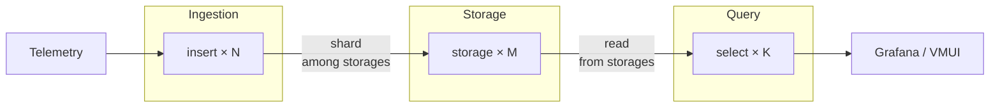

**VictoriaStack** is an observability stack for metrics, logs, and traces. 

| Signal      | Product                                                              | Query language                                                                                                                                                                                                                                  | Scalability                                                                 |
|-------------|----------------------------------------------------------------------|-------------------------------------------------------------------------------------------------------------------------------------------------------------------------------------------------------------------------------------------------|-----------------------------------------------------------------------------|
| **Metrics** | [VictoriaMetrics](https://docs.victoriametrics.com/victoriametrics/) | [MetricsQL](https://docs.victoriametrics.com/metricsql/) (PromQL-compatible)                                                                                                                                                                    | Billions of [active time series](), Millions of samples ingested per second |
| **Logs**    | [VictoriaLogs](https://docs.victoriametrics.com/victorialogs/)       | [LogsQL](https://docs.victoriametrics.com/victorialogs/logsql/)                                                                                                                                                                                 | Hundreds of TBs a day, with avg compression ratio of x15                    |
| **Traces**  | [VictoriaTraces](https://docs.victoriametrics.com/victoriatraces/)   | [LogsQL](https://docs.victoriametrics.com/victorialogs/logsql/), [Jaeger API](https://docs.victoriametrics.com/victoriatraces/querying/#jaeger-http-api), [Tempo API](https://docs.victoriametrics.com/victoriatraces/querying/#tempo-http-api) | Billions of spans per day with avg compression ratio of x15                 |

<br>

Each database is a separate application, specialized on its own signal. But all three share the same design philosophy,
operational model, and ecosystem.

The stack has no bundled all-in-one UI. [Grafana](http://localhost:1313/victoriastack/ui/#grafana) brings all three
signals onto shared dashboards, and every database ships with a built-in [vmui](http://localhost:1313/victoriastack/ui/#vmui) for ad-hoc exploration.

## Why VictoriaStack?

VictoriaStack software is built on three core principles: **simplicity, reliability, and efficiency**.
It is easy to run and maintain, it fits well in home labs and can be reliably scaled to large production
environments. Each of the databases was heavily battle-tested in production environments.

The stack is focusing on what matters most for each signal. VictoriaMetrics is optimized
for time series workload, while VictoriaLogs design and architecture are optimized for log ingestion.
The separation of storage backends allows keeping solutions simple, efficient, independent, and fine-tuned for each
signal.

VictoriaStack [accepts the protocols](http://localhost:1313/victoriastack/ingestion/) popular agents already speak:
* **Metrics**: Prometheus `remote_write`, OpenTelemetry, InfluxDB line, Graphite, DataDog, OpenTSDB.
* **Logs**: Elasticsearch bulk, Loki JSON, syslog, journald, DataDog, OpenTelemetry.
* **Traces**: OpenTelemetry.

VictoriaMetrics serves a Prometheus-compatible API, and VictoriaTraces serves Jaeger- and Tempo-compatible APIs.
Existing Grafana dashboards, alerting and recording rules keep working.

The stack supports multitenancy, alerting, out-of-order backfilling, efficient compression, sane defaults for simplified 
setup, wide community and support.

VictoriaStack is the best choice if you want to **own your observability stack**, build a **reliable**, 
**cost-efficient multitenant platform** ready for future growth.

Already running another observability stack? See [Comparisons](http://localhost:1313/victoriastack/comparisons/)
to learn how VictoriaStack differs from Grafana LGTM, ClickStack, SigNoz, Elastic Stack, and Prometheus with Thanos,
and when each alternative is the better fit.

## Architecture Overview


{width="700"}

| What                                                                                    | How                                                                                                                                                                                                                                                                                |
|-----------------------------------------------------------------------------------------|------------------------------------------------------------------------------------------------------------------------------------------------------------------------------------------------------------------------------------------------------------------------------------|
| **[Deployment](http://localhost:1313/victoriastack/deployment/)**                       | [Kubernetes Operator](http://localhost:1313/victoriastack/deployment/#victoriametrics-operator), [Helm charts](http://localhost:1313/victoriastack/deployment/#helm-charts), [Binaries](http://localhost:1313/victoriastack/deployment/#binary)                                    |
| **[Ingestion integrations](http://localhost:1313/victoriastack/ingestion/)**            | [OpenTelemetry](http://localhost:1313/victoriastack/ingestion/#opentelemetry), [Vector](https://vector.dev/), [Grafana Alloy](https://grafana.com/docs/alloy/latest/), [10+ additional integrations](http://localhost:1313/victoriastack/ingestion/#integrations)                  |
| **[Native ingestion](http://localhost:1313/victoriastack/ingestion/#native-ingestion)** | **High throughput, reliable on-disk buffering, replication, traffic compression** via [vmagent](http://localhost:1313/victoriastack/ingestion/#vmagent) for metrics and [vlagent](http://localhost:1313/victoriastack/ingestion/#vlagent) for logs.                                |
| **[Access control](http://localhost:1313/victoriastack/access-control/)**               | [vmauth](https://docs.victoriametrics.com/victoriametrics/vmauth/) for [user's authentication](http://localhost:1313/victoriastack/access-control/#authenticate-users), [requests routing](http://localhost:1313/victoriastack/access-control/#tenants-filtering), load balancing. |
| **[Visualization](http://localhost:1313/victoriastack/ui/)**                            | [Grafana](http://localhost:1313/victoriastack/ui/#grafana) and [Perses](http://localhost:1313/victoriastack/ui/#perses) for unified observability and dashboarding. Built-in [vmui](http://localhost:1313/victoriastack/ui/#vmui) for ad-hoc exploration.                          |
| **[Alerting](http://localhost:1313/victoriastack/alerting/)**                           | [vmalert](https://docs.victoriametrics.com/victoriametrics/vmalert/) integrated with [Alertmanager](http://localhost:1313/victoriastack/alerting/#alertmanager) for rules evaluation and dispatching notifications                                                                 |
| **[Anomaly detection]()**                                                               | [vmanomaly]() ...                                                                                                                                                                                                                                                                  |
| **[Enterprise](), [Long Term Support(LTS) releases]()**                                 |                                                                                                                                                                                                                                                                                    |

// TODO: add links to stack components

## Quick Start

> If you're looking for a visual impression of the VictoriaStack,
> visit [Playgrounds page](https://docs.victoriametrics.com/playgrounds/)
> and try publicly running installations fed
> with [OpenTelemetry Astronomy Shop demo](https://github.com/open-telemetry/opentelemetry-demo) data.

VictoriaStack can be deployed on bare metal as binaries, as docker containers, using helm charts, or Kubernetes
operator.
See more detailed [deployment docs](http://localhost:1313/victoriastack/deployment/).

In the sections below, we'll go through examples of deploying VictoriaStack via docker compose to make it is
easy to run and experiment with locally.

### Prerequisites

To run the examples below, install [Docker](https://docs.docker.com/get-started/get-docker/)
with [Compose v2](https://docs.docker.com/compose/) and `git`.

### Single-node version

The simplest version of the stack would be to run VictoriaMetrics, VictoriaLogs and VictoriaTraces as single-node
deployments. To
run [the stack locally with docker compose](https://github.com/VictoriaMetrics/VictoriaStack/blob/main/deployment/otel-single-node-compose.yml)
use the following command:

```sh
git clone https://github.com/VictoriaMetrics/VictoriaStack.git && cd VictoriaStack
make otel-single-up
```

All manifests and configs that run this environment are available
at [VictoriaStack/deployment](https://github.com/VictoriaMetrics/VictoriaStack/blob/main/deployment/otel-single-node-compose.yml).

> Note: the Docker Compose environment is very much simplified for demonstration purposes -
> it is **not intended for production use**.

The compose command will start:

- Generator of telemetry + OpenTelemetry collector;
- Single-node versions of VictoriaMetrics, VictoriaLogs, VictoriaTraces for storing and querying signals;
- vmalert for executing alerting rules;
- Grafana for visualizing signals;
- vmauth as a single entrypoint, that will authorize and route requests to the appropriate VictoriaStack component.


Once running for a few minutes, the following links will be available:

- Visit [VictoriaMetrics UI - http://localhost:8427/metrics/select/vmui](http://localhost:8427/metrics/select/vmui/?#/cardinality)
  to explore the stored metrics or [run a query to plot charts](http://localhost:8427/metrics/select/vmui/#/?g0.range_input=15m&g0.relative_time=last_15_minutes&g0.tab=0&g0.expr=sum%28rate%28vm_http_requests_total%29%29+by+%28path%29+%3E+0):
  
  {width="500"}
- Visit [VictoriaLogs UI - http://localhost:8427/logs/select/vmui](http://localhost:8427/logs/select/vmui) to see recently
  ingested logs or [run a query to plot charts](http://localhost:8427/logs/select/vmui/?#/?g0.range_input=5m&g0.relative_time=last_5_minutes&step=5s&query=Error+%7C+by%28http.method%29+count%28%29&group_hits=http.method):
  
  {width="500"}
- [VictoriaTraces UI - http://localhost:8427/traces/select/vmui](http://localhost:8427/traces/select/vmui), but it is
  better to use [Grafana's Explore via Jaeger](http://localhost:3000/explore?schemaVersion=1&panes=%7B%220ut%22:%7B%22datasource%22:%22victoriatraces-jaeger-ds%22,%22queries%22:%5B%7B%22refId%22:%22A%22,%22datasource%22:%7B%22type%22:%22jaeger%22,%22uid%22:%22victoriatraces-jaeger-ds%22%7D,%22queryType%22:%22search%22,%22service%22:%22otelgen%22%7D%5D,%22range%22:%7B%22from%22:%22now-1h%22,%22to%22:%22now%22%7D,%22compact%22:false%7D%7D&orgId=1)(_login with admin:admin_):
  
  {width="500"}
- [Grafana - http://localhost:3000](http://localhost:3000/explore) with preconfigured datasources
  and a simple demo dashboard (_login with admin:admin_):
  
  {width="500"}

While running, the generator will continue pushing telemetry signals via OpenTelemetry collector to the stack, and
vmalert will execute alerting rules. To stop the stack, run the following command:

```sh
make otel-single-down
```

The single-node version of the stack is the best and simplest to start with, experiment and learn how components are
interconnected. To see how to scale stack horizontally - see the [clustered version](#clustered-version) of the stack.

### Clustered version

To start
the [clustered version of the stack](https://github.com/VictoriaMetrics/VictoriaStack/blob/main/deployment/otel-cluster-compose.yml)
run the following command:

```sh
git clone https://github.com/VictoriaMetrics/VictoriaStack.git && cd VictoriaStack
make otel-cluster-up
```

All manifests and configs that run this environment are available
at [VictoriaStack/deployment](https://github.com/VictoriaMetrics/VictoriaStack/blob/main/deployment/otel-cluster-compose.yml).

It runs the same setup as the [single-node version](#single-node-version), but each database is deployed in a clustered
version, represented by three independently scalable types of components: insert, select and storage.
In this topology, vmauth also balances requests among insert and select components.


Once running, the links remain the same as for single-node deployment - all thanks to vmauth handling the routing:

- Visit [VictoriaMetrics UI - http://localhost:8427/metrics/select/vmui](http://localhost:8427/metrics/select/vmui/?#/cardinality)
  to explore the stored metrics or [run a query to plot charts](http://localhost:8427/metrics/select/vmui/#/?g0.range_input=15m&g0.relative_time=last_15_minutes&g0.tab=0&g0.expr=sum%28rate%28vm_http_requests_total%29%29+by+%28path%29+%3E+0)
- Visit [VictoriaLogs UI - http://localhost:8427/logs/select/vmui](http://localhost:8427/logs/select/vmui) to see recently
  ingested logs or [run a query to plot charts](http://localhost:8427/logs/select/vmui/?#/?g0.range_input=5m&g0.relative_time=last_5_minutes&step=5s&query=Error+%7C+by%28http.method%29+count%28%29&group_hits=http.method)
- [VictoriaTraces UI - http://localhost:8427/traces/select/vmui](http://localhost:8427/traces/select/vmui), but it is
  better to use [Grafana's Explore via Jaeger](http://localhost:3000/explore?schemaVersion=1&panes=%7B%220ut%22:%7B%22datasource%22:%22victoriatraces-jaeger-ds%22,%22queries%22:%5B%7B%22refId%22:%22A%22,%22datasource%22:%7B%22type%22:%22jaeger%22,%22uid%22:%22victoriatraces-jaeger-ds%22%7D,%22queryType%22:%22search%22,%22service%22:%22otelgen%22%7D%5D,%22range%22:%7B%22from%22:%22now-1h%22,%22to%22:%22now%22%7D,%22compact%22:false%7D%7D&orgId=1)(_login with admin:admin_)
- [Grafana - http://localhost:3000](http://localhost:3000/explore) with preconfigured datasources
  and a simple demo dashboard (_login with admin:admin_)

While running, the generator will continue pushing telemetry signals via OpenTelemetry collector to the stack, and
vmalert will execute alerting rules. To stop the stack, run the following command:

```sh
make otel-cluster-down
```

### Scalability

VictoriaMetrics, VictoriaLogs and VictoriaTraces are designed to be highly scalable and simple to operate:

- one VictoriaMetrics cluster can handle thousands of tenants, billions of time series, millions of samples per second,
  thousands of read requests per second;
- one VictoriaLogs cluster can handle thousands of tenants, hundreds of terabytes of logs per day,
  thousands of read requests per second;
- one VictoriaTraces cluster can handle thousands of tenants, billions of spans per day with avg compression ratio of
  x15.

All 3 databases share similar architecture and can be scaled independently:



Each database has 3 types of components:

* stateless **insert** - processes incoming data and shards it between storages;
* stateful **storage** - efficiently stores and manages data;
* stateless **select** - processes incoming read queries and returns results.

**insert** and **select** components need to know only about **storages**, they don't need to know about each other.
And **storages** don't know about each other, **inserts** or **selects**.

**inserts**, **selects** and **storages** can be scaled independently:

* add more **insert** replicas to increase ingestion throughput;
* add more **select** replicas to increase query throughput.
* add more **storage** shards to increase overall performance and overcome physical hardware limitations like CPU/Mem/IO
  limits
  or filesystem capacity.

Cluster architecture doesn't require any additional services: no extra caches, databases, compactors, etc. We only
recommend using [vmauth for load balancing](http://localhost:1313/victoriametrics/vmauth/#load-balancing) for stateless
components, or any other load balancer of your choice.

## Retention and storage

All three databases store data on the local filesystem and delete it automatically once it falls outside the
configured retention:

| Database                                                                                                     | Default retention | How to configure                                                                                               |
|--------------------------------------------------------------------------------------------------------------|-------------------|----------------------------------------------------------------------------------------------------------------|
| [VictoriaMetrics](https://docs.victoriametrics.com/victoriametrics/single-server-victoriametrics/#retention) | 1 month           | `-retentionPeriod`, from `1d` up to years                                                                      |
| [VictoriaLogs](https://docs.victoriametrics.com/victorialogs/#retention)                                     | 7 days            | `-retentionPeriod`, or a disk limit via `-retention.maxDiskSpaceUsageBytes` / `-retention.maxDiskUsagePercent` |
| [VictoriaTraces](https://docs.victoriametrics.com/victoriatraces/#retention)                                 | 7 days            | `-retentionPeriod`, or a disk limit via `-retention.maxDiskSpaceUsageBytes` / `-retention.maxDiskUsagePercent` |

Disk usage depends on your data, not on a fixed formula. Estimate it with the capacity planning docs
for [VictoriaMetrics](https://docs.victoriametrics.com/victoriametrics/single-server-victoriametrics/#capacity-planning)
and [VictoriaLogs](https://docs.victoriametrics.com/victorialogs/#capacity-planning).

VictoriaStack has no object storage tiering: databases keep all data on local disks, and S3 or GCS is used
for [backups](http://localhost:1313/victoriastack/deployment/#backups) only. Support for historical data in object
storage is in progress, see [this issue](https://github.com/VictoriaMetrics/VictoriaLogs/issues/48).

To store metrics longer without paying for full resolution,
Enterprise adds [downsampling](https://docs.victoriametrics.com/victoriametrics/single-server-victoriametrics/#downsampling)
and per-tenant [retention filters](https://docs.victoriametrics.com/victoriametrics/single-server-victoriametrics/#retention-filters).

## Next steps

The examples above run on generated telemetry. To build an installation of your own, go through the following steps:

1. [Ingest your own data](http://localhost:1313/victoriastack/ingestion/): point the telemetry agents you already run at
   VictoriaStack, or use vmagent and vlagent for higher throughput and reliable delivery.
2. [Query the signals](http://localhost:1313/victoriastack/querying/): MetricsQL for metrics, LogsQL for logs and traces.
3. [Build dashboards](http://localhost:1313/victoriastack/ui/): Grafana or Perses for dashboarding, vmui for ad-hoc
   exploration.
4. [Set up alerting](http://localhost:1313/victoriastack/alerting/): vmalert for rules evaluation, Alertmanager for
   notifications.
5. [Protect the installation](http://localhost:1313/victoriastack/access-control/): vmauth for authentication, request
   routing, and TLS termination.
6. [Separate data between teams](http://localhost:1313/victoriastack/multitenancy/): one installation can serve
   thousands of isolated tenants.
7. [Deploy to production](http://localhost:1313/victoriastack/deployment/): Kubernetes operator, Helm charts, or
   binaries. The docker compose examples above are for demonstration only.