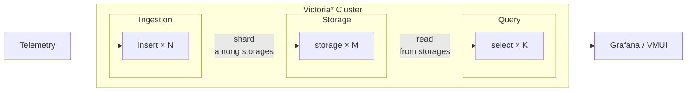

**VictoriaStack** is an open source observability stack for metrics, logs, and traces.

| Signal      | Product                                                              | Query language                                                                                                                                                                                                                                  | Scalability                                                                                                                                                    |
|-------------|----------------------------------------------------------------------|-------------------------------------------------------------------------------------------------------------------------------------------------------------------------------------------------------------------------------------------------|----------------------------------------------------------------------------------------------------------------------------------------------------------------|
| **Metrics** | [VictoriaMetrics](https://docs.victoriametrics.com/victoriametrics/) | [MetricsQL](https://docs.victoriametrics.com/metricsql/) (PromQL-compatible)                                                                                                                                                                    | Billions of [active time series](https://docs.victoriametrics.com/victoriametrics/faq/#what-is-an-active-time-series), Millions of samples ingested per second |
| **Logs**    | [VictoriaLogs](https://docs.victoriametrics.com/victorialogs/)       | [LogsQL](https://docs.victoriametrics.com/victorialogs/logsql/)                                                                                                                                                                                 | Hundreds of TBs a day, with avg post-compression ratio of x15                                                                                                  |
| **Traces**  | [VictoriaTraces](https://docs.victoriametrics.com/victoriatraces/)   | [LogsQL](https://docs.victoriametrics.com/victorialogs/logsql/), [Jaeger API](https://docs.victoriametrics.com/victoriatraces/querying/#jaeger-http-api), [Tempo API](https://docs.victoriametrics.com/victoriatraces/querying/#tempo-http-api) | Billions of spans per day with avg post-compression ratio of x15                                                                                               |

 

Each database is a separate application, specialized for its own signal. All three share the same design philosophy,
operational model, and ecosystem.

All three databases are open-source and free to use, Apache-2.0 licensed.

## Why VictoriaStack?

VictoriaStack is built on three core principles: **simplicity, reliability, and efficiency**.
It is easy to run and maintain. It fits well in home labs and scales reliably to large production environments,
and each database is battle-tested in production.

The stack focuses on what matters most for each signal. VictoriaMetrics is optimized for time series workloads,
while VictoriaLogs is optimized for wide events (logs and traces). Separate storage backends keep each database
simple, efficient, independent, and fine-tuned for its signal. No schema or index design is required: push the data
and VictoriaStack takes care of the rest.

VictoriaStack [accepts the most popular ingestion protocols](https://docs.victoriametrics.com/victoriastack/ingestion/):

* **Metrics**: Prometheus `remote_write`, OpenTelemetry, InfluxDB line, Graphite, DataDog, OpenTSDB.
* **Logs**: Elasticsearch bulk, Loki JSON, syslog, journald, DataDog, OpenTelemetry.
* **Traces**: OpenTelemetry.

VictoriaMetrics serves a Prometheus-compatible API, and VictoriaTraces serves Jaeger- and Tempo-compatible APIs.
Existing Grafana dashboards, alerting rules, and recording rules keep working.

The stack supports multitenancy, alerting, out-of-order backfilling, efficient compression, and sane defaults
that simplify the setup.

Choose VictoriaStack to **own your observability** and build a **reliable**,
**cost-efficient multitenant platform** ready for future growth.

> Already running another observability stack? See [Comparisons](https://docs.victoriametrics.com/victoriastack/comparisons/)
> to learn how VictoriaStack differs from Grafana LGTM, ClickStack, SigNoz, Elastic Stack, and Prometheus+Thanos,
> and when each alternative is the better fit.

## Architecture

VictoriaStack runs the three databases as independent installations,
with [vmauth](https://docs.victoriametrics.com/victoriametrics/vmauth) as a single entrypoint that routes and load balances
requests:

{width="700"}

All three databases share the same component model. Each of them runs either as a single binary or as a cluster
of three component types:

* stateless **insert**: processes incoming data and shards it among storages;
* stateful **storage**: efficiently stores and manages data;
* stateless **select**: processes incoming read queries and returns results.

**insert** and **select** components need to know only about **storages**. They don't know about each other, and
**storages** don't know about **inserts**, **selects**, or other **storages**. This design allows flexible topologies
with sub-clusters, where **inserts** or **selects** connect to all or to a subset of **storages**.

Cluster architecture doesn't require any additional services: no extra caches, databases, or compactors. For stateless
components we recommend [vmauth as a load balancer](https://docs.victoriametrics.com/victoriametrics/vmauth/#load-balancing),
or any other load balancer of your choice.

## What's in the stack

| What                                                                                               | How                                                                                                                                                                                                                                                                                                                                                                                             |
|----------------------------------------------------------------------------------------------------|-------------------------------------------------------------------------------------------------------------------------------------------------------------------------------------------------------------------------------------------------------------------------------------------------------------------------------------------------------------------------------------------------|
| **[Deployment](https://docs.victoriametrics.com/victoriastack/deployment/)**                       | [Kubernetes Operator](https://docs.victoriametrics.com/victoriastack/deployment/#victoriametrics-operator), [Helm charts](https://docs.victoriametrics.com/victoriastack/deployment/#helm-charts), [Binaries](https://docs.victoriametrics.com/victoriastack/deployment/#binary)                                                                                                                |
| **[Ingestion integrations](https://docs.victoriametrics.com/victoriastack/ingestion/)**            | [OpenTelemetry](https://docs.victoriametrics.com/victoriastack/ingestion/#opentelemetry), [Vector, Grafana Alloy, 10+ additional integrations](https://docs.victoriametrics.com/victoriastack/ingestion/#agents-and-protocols)                                                                                                                                                                  |
| **[Native ingestion](https://docs.victoriametrics.com/victoriastack/ingestion/#native-ingestion)** | **High throughput, reliable on-disk buffering, replication, traffic compression** via [vmagent](https://docs.victoriametrics.com/victoriastack/ingestion/#vmagent) for metrics, [vlagent](https://docs.victoriametrics.com/victoriastack/ingestion/#vlagent) for logs, [vtagent](https://docs.victoriametrics.com/victoriastack/ingestion/#vtagent) for traces.                                 |
| **[Access control](https://docs.victoriametrics.com/victoriastack/access-control/)**               | [vmauth](https://docs.victoriametrics.com/victoriametrics/vmauth/) for [user's authentication](https://docs.victoriametrics.com/victoriastack/access-control/#authentication), [requests routing](https://docs.victoriametrics.com/victoriastack/access-control/#routing-and-load-balancing), [per-tenant access](https://docs.victoriametrics.com/victoriastack/access-control/#multitenancy). |
| **[Visualization](https://docs.victoriametrics.com/victoriastack/ui/)**                            | [Grafana](https://docs.victoriametrics.com/victoriastack/ui/#grafana) and [Perses](https://docs.victoriametrics.com/victoriastack/ui/#perses) for unified observability and dashboarding. Built-in [vmui](https://docs.victoriametrics.com/victoriastack/ui/#vmui) for ad-hoc exploration.                                                                                                      |
| **[Alerting](https://docs.victoriametrics.com/victoriastack/alerting/)**                           | vmalert integrated with [Alertmanager](https://docs.victoriametrics.com/victoriastack/alerting/#alertmanager) for rules evaluation and dispatching notifications                                                                                                                                                                                                                                |
| **[Anomaly detection](https://docs.victoriametrics.com/victoriastack/anomaly-detection/)**         | [vmanomaly](https://docs.victoriametrics.com/anomaly-detection/) learns expected data behavior and writes a [unified anomaly score](https://docs.victoriametrics.com/anomaly-detection/faq/#what-is-anomaly-score) to VictoriaMetrics for contextual alerting and investigation.                                                                                                                |
| **Extended support via [Enterprise](https://docs.victoriametrics.com/victoriastack/enterprise)**   | [Long Term Support(LTS) releases](https://docs.victoriametrics.com/victoriastack/enterprise/#long-term-support-releases), consulting, architectural guidance, solutions engineering.                                                                                                                                                                                                            |

 

Navigate documentation for available components using left navigation menu. Start with [Quick Start](https://docs.victoriametrics.com/victoriastack/quick-start/) to begin using VictoriaStack.

## Get help

* Ask questions in the community [Slack](https://slack.victoriametrics.com/)
  or [Telegram](https://t.me/VictoriaMetrics_en).
  See the [full list of channels](https://docs.victoriametrics.com/victoriametrics/#community-and-contributions).
* Report bugs and request features in GitHub
  issues: [VictoriaMetrics](https://github.com/VictoriaMetrics/VictoriaMetrics/issues),
  [VictoriaLogs](https://github.com/VictoriaMetrics/VictoriaLogs/issues),
  [VictoriaTraces](https://github.com/VictoriaMetrics/VictoriaTraces/issues).
  Found a problem on this page? [Open an issue](https://github.com/VictoriaMetrics/VictoriaStack/issues).
* For commercial support and [enterprise features](https://docs.victoriametrics.com/victoriametrics/enterprise/),
  contact [info@victoriametrics.com](mailto:info@victoriametrics.com).