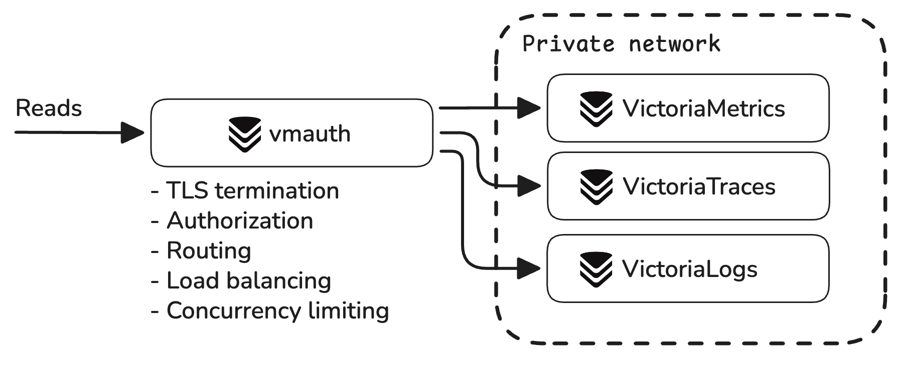

VictoriaMetrics, VictoriaLogs, and VictoriaTraces components **must run inside a protected trusted network**.
The databases don't authenticate requests and don't limit access to the stored data: every client that reaches them can
read and write everything.

For internet-facing deployments, put [vmauth](https://docs.victoriametrics.com/victoriametrics/vmauth/) or another
authentication proxy in front of the databases:



vmauth can perform the following actions:

- [Requests authorization](https://docs.victoriametrics.com/victoriametrics/vmauth/#authorization): Basic Auth, Bearer
  Token, JWT, etc.
- [Requests routing](https://docs.victoriametrics.com/victoriametrics/vmauth/#routing): by tenant, path, host, header,
  query args, etc.
- [Load balancing](https://docs.victoriametrics.com/victoriametrics/vmauth/#load-balancing)
- [TLS termination](https://docs.victoriametrics.com/victoriametrics/vmauth/#tls-termination-proxy)
- [Access logging](https://docs.victoriametrics.com/victoriametrics/vmauth/#access-log)
- [Automatic issuing of TLS certificates](https://docs.victoriametrics.com/victoriametrics/vmauth/#automatic-issuing-of-tls-certificates),
  [mTLS protection](https://docs.victoriametrics.com/victoriametrics/vmauth/#mtls-protection) and [mTLS routing](http://localhost:1313/victoriametrics/vmauth/#mtls-based-request-routing),
  [IP filtering](https://docs.victoriametrics.com/victoriametrics/vmauth/#ip-filters) in the [Enterprise](http://localhost:1313/victoriastack/enterprise/) version

The sections below cover the common setups: routing requests to the databases, authenticating users, giving every user
its own tenant, and restricting the endpoints they can reach.

## Routing and load balancing

The following vmauth configuration acts as a gateway between VictoriaStack components and users:

```yaml
# unauthorized_user doesn't expect any credentials to be provided
unauthorized_user:
  url_map:
    - src_paths: [ "/metrics/.*" ]
      url_prefix: "http://victoriametrics:8428/"
      drop_src_path_prefix_parts: 1 # drops the /metrics prefix before forwarding the request

    - src_paths: [ "/logs/.*" ]
      url_prefix: "http://victorialogs:9428/"
      drop_src_path_prefix_parts: 1

    - src_paths: [ "/traces/.*" ]
      url_prefix: "http://victoriatraces:10428/"
      drop_src_path_prefix_parts: 1
```

With the configuration above, each service can be accessed via the vmauth endpoint using its own URL:

- `https://vmauth/metrics/...` - to access VictoriaMetrics
- `https://vmauth/logs/...` - to access VictoriaLogs
- `https://vmauth/traces/...` - to access VictoriaTraces

A clustered installation runs several replicas of every component. List all of them in `url_prefix`, and vmauth spreads
the requests among the replicas with a least-loaded round-robin policy:

```yaml
unauthorized_user:
  url_map:
    - src_paths: [ "/metrics/select/.*" ]
      url_prefix:
        - "http://vmselect-1:8481/"
        - "http://vmselect-2:8481/"
      drop_src_path_prefix_parts: 1 # drops the /metrics prefix before forwarding the request
      retry_status_codes: [ 500, 502 ]
```

vmauth detects temporarily unavailable backends and spreads requests among the remaining ones, so replicas can be
restarted or upgraded without removing them from the config. With `retry_status_codes` it also retries the listed
responses on another backend.

## Authentication

The following vmauth configuration allows access to metrics and logs backends only to users with `admin` credentials:

```yaml
users:
  - username: admin
    password: "***"
    url_map:
      - src_paths: [ "/metrics/.*" ]
        url_prefix: "http://victoriametrics:8428/"
        drop_src_path_prefix_parts: 1 # drops the /metrics prefix before forwarding the request

      - src_paths: [ "/logs/.*" ]
        url_prefix: "http://victorialogs:9428/"
        drop_src_path_prefix_parts: 1
```

See advanced authorization examples via [Headers, Bearer and JWT tokens](https://docs.victoriametrics.com/victoriametrics/vmauth/#authorization)
or how to [Setup multitenant access with Grafana & OIDC](https://docs.victoriametrics.com/guides/grafana-vmauth-openid-configuration/).

## Multitenancy

All three databases identify a [tenant](http://localhost:1313/victoriastack/multitenancy/) by the `AccountID` and
`ProjectID` HTTP headers. vmauth sets these headers per user, so the credentials decide to which tenant to route the requests:

```yaml
users:
  - username: team-dev
    password: "***"
    url_map:
      - src_paths: [ "/logs/.*" ]
        url_prefix: "http://victorialogs:9428/"
        drop_src_path_prefix_parts: 1 # drops the /metrics prefix before forwarding the request
        headers:
          - "AccountID: 2"
          - "ProjectID: 4"

  - username: team-prod
    password: "***"
    url_map:
      - src_paths: [ "/logs/.*" ]
        url_prefix: "http://victorialogs:9428/"
        drop_src_path_prefix_parts: 1
        headers:
          - "AccountID: 1"
          - "ProjectID: 1"
      - src_paths: [ "/traces/.*" ]
        url_prefix: "http://victoriatraces:10428/"
        drop_src_path_prefix_parts: 1
        headers:
          - "AccountID: 1"
          - "ProjectID: 1"
```

In the config above:
- user `team-dev` can **access logs** only from tenant `AccountID: 2; ProjectID: 4`
- user `team-prod` can **access logs and traces** only from tenant `AccountID: 1; ProjectID: 1`
 
Since tenant IDs are numeric, configration like above shows how a string username maps to a numeric tenant.

See [Multitenancy](http://localhost:1313/victoriastack/multitenancy/) for the tenant model itself, and the
[per-tenant authorization docs](https://docs.victoriametrics.com/victoriametrics/vmauth/#per-tenant-authorization) for
more vmauth examples.

## Endpoints filtering

The `src_paths` in [vmauth config](https://docs.victoriametrics.com/victoriametrics/vmauth/#auth-config) can be further
modified to allow access only to specific paths:

```yaml
  - src_paths:
      - "/metrics/api/v1/query"
      - "/metrics/api/v1/query_range"
      - "/metrics/api/v1/series"
      - "/metrics/api/v1/labels"
      - "/metrics/api/v1/label/.+/values"
    url_prefix: "http://victoriametrics:8428/"
```

With this configuration, authorized users can query metrics and use Grafana as usual, but they cannot ingest data or
access [sensitive endpoints](#sensitive-endpoints), like `/api/v1/admin/tsdb/delete_series`.

## Sensitive endpoints

VictoriaStack components, including vmauth, expose sensitive endpoints for config hot reloading, metrics scraping,
profiling, etc.
It is recommended to protect these endpoints from public or unauthorized access. Follow per-component recommendations
below:

- [vmauth security](https://docs.victoriametrics.com/victoriametrics/vmauth/#security)
- [VictoriaMetrics security](https://docs.victoriametrics.com/victoriametrics/#general-security-recommendations)
- [VictoriaLogs system endpoints](https://docs.victoriametrics.com/victorialogs/security-and-lb/#system-endpoints)
- [VictoriaTraces security](https://docs.victoriametrics.com/victoriatraces/#security)
- [vmalert security](https://docs.victoriametrics.com/victoriametrics/vmalert/#security)
