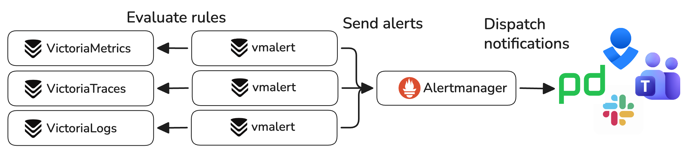
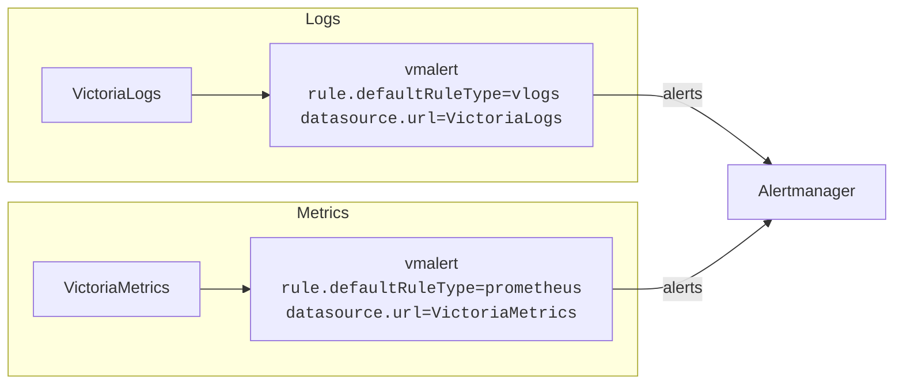
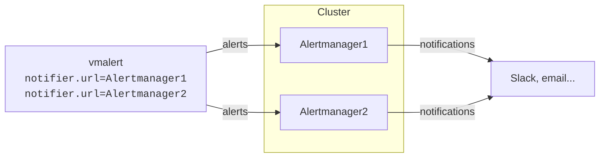

Alerting evaluates rules against metrics, logs, or traces and sends notifications when conditions are met. Common examples include service outages, error messages in log entries, spikes in HTTP request rate, or slow traces.

In VictoriaStack, [vmalert](https://docs.victoriametrics.com/victoriametrics/vmalert/) component acts as an alerting engine and
integrates with [Alertmanager](https://github.com/prometheus/alertmanager) for dispatching alerting notifications
to various destinations like [email, Slack, PagerDuty, MS Teams, etc](https://prometheus.io/docs/alerting/latest/integrations/#available-integrations).



It is recommended to use a separate vmalert instance for each signal type. This simplifies rules configuration and
isolates pipelines for different signal types. However, it is still possible to use a single vmalert instance for
[multiple signal types](https://docs.victoriametrics.com/victorialogs/vmalert/#how-to-use-one-vmalert-for-victorialogs-and-victoriametrics-rules-at-the-same-time).


## Quick Start

The following things are required to start using alerting:
1. A list of [rules](#rules) to execute.
2. A datasource URL to execute the rules against.
3. Alertmanager service URL to send notifications to.

vmalert is a single binary service that can be started with the following command:
```sh
./path/to/vmalert \
    -rule=alert.rules \
    -datasource.url=http://victoriametrics:8428 \
    -notifier.url=http://alertmanager:9093 \
    -remoteWrite.url=http://victoriametrics:8428 \
    -remoteRead.url=http://victoriametrics:8428
```

* `-rule` - path to the file with rules configuration. Supports wildcards and HTTP URLs. S3 and GCS paths are available
  in Enterprise.
* `-datasource.url` - URL to query for rules evaluation.
* `-notifier.url` - Alertmanager URL to send notifications to.
* `-remoteWrite.url` - URL to write the results of [recording rules](#rules) and the state of alerts to. Required for
  recording rules, and for keeping the alert state across restarts.
* `-remoteRead.url` - URL to restore the alert state from on startup.

> See more detailed documentation in [vmalert Quick Start docs](https://docs.victoriametrics.com/victoriametrics/vmalert/#quickstart).

With the configuration above, vmalert will periodically evaluate rules read from the `alert.rules` file by querying the specified
`-datasource.url` and sending notifications to `-notifier.url` if conditions are met.

The key features of vmalert are:
* Supports Prometheus [alerting rules syntax](https://prometheus.io/docs/prometheus/latest/configuration/alerting_rules/#defining-alerting-rules),
  making it easier to migrate from a Prometheus stack.
* Supports [recording rules](https://docs.victoriametrics.com/victoriametrics/vmalert/#recording-rules), allowing you to
  convert query results, logs and traces into metrics. Recording rules write their results to `-remoteWrite.url`.
* [Hot reload](https://docs.victoriametrics.com/victoriametrics/vmalert/#hot-config-reload) of configuration rules from S3, URL, or local file system.
* Persists [alert state across restarts](https://docs.victoriametrics.com/victoriametrics/vmalert/#alerts-state-on-restarts)
  when `-remoteWrite.url` and `-remoteRead.url` are set. Without them vmalert keeps the state in memory only, and a
  restart resets all active alerts.
* Supports recording and alerting rules backfilling (`replay`). See [these docs](https://docs.victoriametrics.com/victoriametrics/vmalert/#rules-backfilling) to learn more.

## Rules

vmalert is configured with [rules in yaml format](https://docs.victoriametrics.com/victoriametrics/vmalert/#groups) that it can
fetch from the local file system, remote URL, or object storage. Rules are configured using regular query expressions
in the corresponding language. For example, the following alerting rule for VictoriaLogs triggers if the number of `error`
or `warn` logs on a single pod in `env=prod` exceeds 10 during the last 5 minutes:
```yaml
groups:
  - name: ServiceLog
    type: vlogs # The type is set to query VictoriaLogs
    interval: 5m
    rules:
      - alert: HasMoreThan10ErrorLogs
        expr: '{env=prod} status:in(error,warn) | stats by (k8s.pod.name) count() as error_logs | filter error_logs:>10'
        annotations:
          description: 'Too big number of errors and warnings on pod {{ index .Labels "k8s.pod.name" }} during the last 5 minutes: {{$value}}'
```

See production-ready examples of alerting rules for VictoriaMetrics monitoring [here](https://github.com/VictoriaMetrics/VictoriaMetrics/tree/master/deployment/docker/rules).

## Datasource

Datasource is specified by the `-datasource.url` flag. It is a URL where vmalert can send queries for rules evaluation.
It could be a VictoriaMetrics URL, VictoriaLogs URL or VictoriaTraces URL, depending on the [type of integration](https://docs.victoriametrics.com/victoriametrics/vmalert/#integrations).



vmalert will periodically execute the rules against the configured datasource and send notifications to Alertmanager 
if conditions are met.

## Alertmanager

Alertmanager is specified by the `-notifier.url` flag. It is a URL where vmalert will send notifications if conditions 
in rules are met. Alertmanager then can be configured to send notifications to various destinations like email or slack,
silence, group and suppress alerts. See [Alertmanager docs](https://prometheus.io/docs/alerting/latest/alertmanager/) for more details.



> If you have a cluster of Alertmanager instances, then all of the instances should be specified in the 
`-notifier.url` flag separated by comma.

Alertmanager can be discovered by vmalert via Consul or DNS service discovery. 
See more details in [vmalert docs](https://docs.victoriametrics.com/victoriametrics/vmalert/#notifier-configuration-file).

## High Availability

For High Availability run multiple identically configured vmalert instances. 

```mermaid
flowchart LR

    M["VictoriaMetrics<br/><code>dedup.minScrapeInterval=evalInterval</code>"]

    subgraph HA["HA vmalert"]
        direction LR

        V1["vmalert<br/><code>notifier.url=Alertmanager<br/>datasource.url=VictoriaMetrics</code>"]
        V2["vmalert<br/><code>notifier.url=Alertmanager<br/>datasource.url=VictoriaMetrics</code>"]
    end

    A["Alertmanager"]

    M -->|"queries"| V1
    M -->|"queries"| V2

    V1 -->|"alerts"| A
    V2 -->|"alerts"| A
 ```

It means all of them will execute the same rules **doubling the resource usage on datasource**, and send alert notifications to multiple configured 
Alertmanagers. See more details in [vmalert docs](https://docs.victoriametrics.com/victoriametrics/vmalert/#ha-vmalert).

Please note, vmalert is stateless and its reload usually doesn't take more than a few seconds. A restarted vmalert
can also [restore the state of its alerts](https://docs.victoriametrics.com/victoriametrics/vmalert/#alerts-state-on-restarts).
Deploying multiple vmalert instances doesn't usually justify extra resource usage on datasource.

## Scalability

vmalert is a very lightweight service that only sends query requests to datasource and alerts to Alertmanager.
It doesn't do any heavy lifting on its own and rarely requires sharding. One vmalert instance can handle thousands of rules
consuming very low amount of resources.

In cases when horizontal scaling is required, it is recommended to manually split configured rules by groups in separate
files and run multiple vmalert instances to execute their own configuration files.
