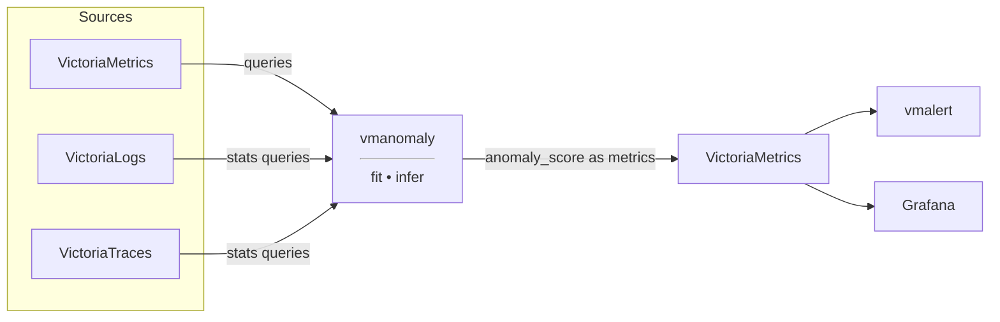

Alerting rules answer the question "is this value above the threshold?". Anomaly detection answers a different one: "is
this behaviour unusual for this time series?". Static thresholds need constant tuning and break on data that grows,
scales, or follows daily and weekly cycles, where a value that is normal on Monday morning is an incident on Sunday
night.

[vmanomaly](https://docs.victoriametrics.com/anomaly-detection/) is the VictoriaStack component that answers the second
question. It applies machine learning models to the data stored in the stack and turns every data point into one
number: an **anomaly score**. Values up to `1` are normal, values above `1` are anomalous, so alerting rules become
as simple as `anomaly_score > 1` and stay valid while the data underneath keeps changing.

> vmanomaly is a part of the [Enterprise](http://localhost:1313/victoriastack/enterprise/) package and requires a
> license key to run. The databases it reads from can be either community or Enterprise edition, single-node or
> clustered. A [trial license](https://victoriametrics.com/products/enterprise/trial/) is available for evaluation.

## How it works

vmanomaly runs as a service next to the databases and periodically repeats two steps:

- **fit**: train a model on a window of historical data, for example the last 3 days;
- **infer**: score the newly arrived data points with that model.

The results are written back into VictoriaMetrics as ordinary metrics, which means the rest of the stack consumes them
with no special support: [vmalert](http://localhost:1313/victoriastack/alerting/) evaluates rules on them, and Grafana
plots them next to the raw data.



All three signals can be analyzed. Metrics are read from VictoriaMetrics directly, while logs and traces reach
vmanomaly as metrics produced by their [stats queries](https://docs.victoriametrics.com/victorialogs/vmalert/index.html), so anomalies in
error rates or span durations are detected the same way as anomalies in CPU usage.

## The anomaly score

`anomaly_score` is a single metric that models produce for every input series:

- **0 to 1** means the observed value matches the expected behaviour;
- **above 1** means the value deviates from it, and the score grows with the size of the deviation.

The cut-off at `1` is deliberate and identical for every model, so one threshold works across all of them and stays
stable over time. Models also return the expected value and its confidence interval as `yhat`, `yhat_lower`, and
`yhat_upper`, which makes an anomaly easy to inspect on a graph: the raw series leaves the shaded band.

The output keeps the labels of the input series and adds a few of its own, so it stays clear which query, model, and
schedule produced the score:

```promtextmetric
anomaly_score{for="cpu_seconds_total", instance="node-exporter:9100", mode="idle", model_alias="mad", scheduler_alias="1d_1m"} 4.23
anomaly_score{for="read_latency", instance="node-exporter:9100", model_alias="mad", scheduler_alias="1d_1m"} 0.27
```

## Quick start with presets

[Presets](https://docs.victoriametrics.com/anomaly-detection/presets/) configure anomaly detection for well-known sets
of metrics, so the only thing left to specify is where to read data from and where to write results to. Every preset
comes with alerting rules and a Grafana dashboard.

```yaml
preset: "node-exporter"
reader:
  datasource_url: "http://victoriametrics:8428/"  # where to read metrics from
  # tenant_id: '0:0'  # specify for the cluster version
writer:
  datasource_url: "http://victoriametrics:8428/"  # where to write anomaly scores to
  # tenant_id: '0:0'  # specify for the cluster version
```

Three presets are available:

| Preset                                                                                | What it does                                                                                |
|---------------------------------------------------------------------------------------|---------------------------------------------------------------------------------------------|
| [`ui`](https://docs.victoriametrics.com/anomaly-detection/presets/#ui)                 | starts the [built-in UI](https://docs.victoriametrics.com/anomaly-detection/ui/) for experimenting with models and backtesting configurations |
| [`node-exporter`](https://docs.victoriametrics.com/anomaly-detection/presets/#node-exporter) | detects anomalies in CPU usage, network errors, disk latency, and other node metrics         |
| [`default`](https://docs.victoriametrics.com/anomaly-detection/presets/#default)        | your own configuration, with a prebuilt dashboard for drilling down into the produced scores |

## Configuration

Outside of presets, a configuration file describes four required sections:

| Section                                                                                   | What it defines                                                        |
|-------------------------------------------------------------------------------------------|------------------------------------------------------------------------|
| [`reader`](https://docs.victoriametrics.com/anomaly-detection/components/reader/)          | where to read data from, and the queries to analyze                    |
| [`schedulers`](https://docs.victoriametrics.com/anomaly-detection/components/scheduler/)   | how often to fit models and to score new data                          |
| [`models`](https://docs.victoriametrics.com/anomaly-detection/components/models/)          | which models to run, and on which queries                              |
| [`writer`](https://docs.victoriametrics.com/anomaly-detection/components/writer/)          | where to write the produced scores                                     |

<br>

A minimal configuration that scores one query looks like this:

```yaml
reader:
  class: 'vm'
  datasource_url: "http://victoriametrics:8428/"
  sampling_period: '1m'
  queries:
    requests_rate:
      expr: 'sum(rate(http_requests_total)) by (path)'
      data_range: [0, 'inf']  # requests rate can never be negative

schedulers:
  periodic:
    class: 'periodic'
    fit_window: '3d'    # how much history to train on
    fit_every: '1h'     # how often to retrain
    infer_every: '1m'   # how often to score new data points

models:
  zscore:
    class: 'zscore_online'
    provide_series: ['anomaly_score', 'yhat', 'yhat_lower', 'yhat_upper']
    queries: ['requests_rate']
    schedulers: ['periodic']

writer:
  datasource_url: "http://victoriametrics:8428/"
```

vmanomaly ships [built-in models](https://docs.victoriametrics.com/anomaly-detection/components/models/#built-in-models)
ranging from simple z-score to seasonal ones, and accepts
[custom models](https://docs.victoriametrics.com/anomaly-detection/components/models/#custom-model-guide) too. Models
are either **univariate**, scoring every series on its own, or
[**multivariate**](https://docs.victoriametrics.com/anomaly-detection/components/models/#multivariate-models), scoring
related series together, which catches patterns that isolated series don't reveal.

> Choosing models and tuning them is the hard part of anomaly detection. The
> [built-in UI](https://docs.victoriametrics.com/anomaly-detection/ui/) backtests a configuration against historical
> data before it goes live, and the [AI tools](https://docs.victoriametrics.com/ai-tools/) can inspect the data and
> generate a validated configuration.

## Alerting on anomalies

Since scores are stored as metrics, alerting on them needs no new tooling. A rule for
[vmalert](http://localhost:1313/victoriastack/alerting/) is a threshold on one metric:

```yaml
groups:
  - name: AnomalyExample
    rules:
      - alert: HighAnomalyScore
        expr: 'anomaly_score > 1.0'
        labels:
          severity: warning
        annotations:
          summary: "Anomalous behaviour detected for {{ $labels.for }} on {{ $labels.instance }}"
```

This rule stays as it is while the monitored data changes, which is the practical benefit over thresholds on raw values.
Presets bring their own rules, so with a preset there is nothing to write at all.

## Deployment

vmanomaly is deployed the same ways as the rest of the
stack, see [Deployment](http://localhost:1313/victoriastack/deployment/) for the general picture:

- **Docker**: the [`victoriametrics/vmanomaly`](https://docs.victoriametrics.com/anomaly-detection/quickstart/#docker)
  image, with the license key and the config file mounted into the container.
- **Helm**: the [victoria-metrics-anomaly](https://github.com/VictoriaMetrics/helm-charts/tree/master/charts/victoria-metrics-anomaly) chart.
- **Kubernetes operator**: the [VMAnomaly](https://docs.victoriametrics.com/operator/resources/vmanomaly/) custom resource.

Two operational topics have their own docs:
[scaling and high availability](https://docs.victoriametrics.com/anomaly-detection/scaling-vmanomaly/) covers sharding
the workload across instances, and
[self-monitoring](https://docs.victoriametrics.com/anomaly-detection/self-monitoring/) ships the dashboards and alerting
rules for the service itself.

## Multitenancy

The `reader` and `writer` sections accept a `tenant_id`, so vmanomaly reads from one
[tenant](http://localhost:1313/victoriastack/multitenancy/) and writes the scores to another, or to the same one. Running
an instance per tenant keeps the models and the produced scores isolated together with the data.
