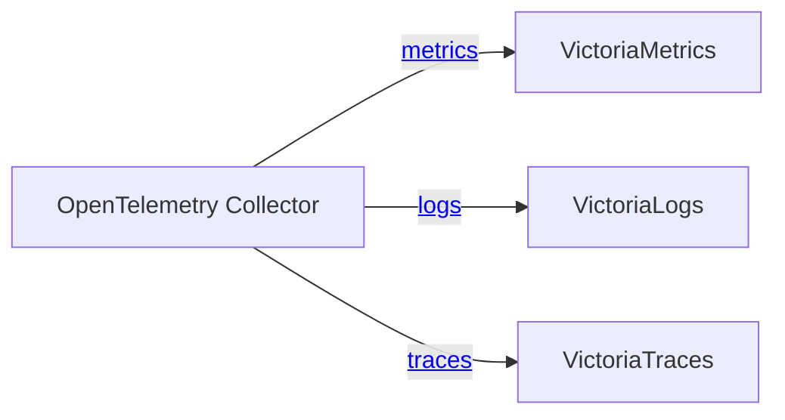
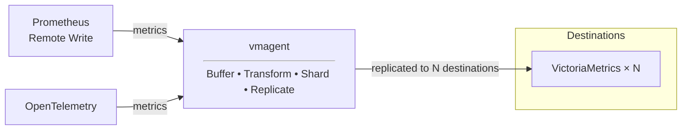
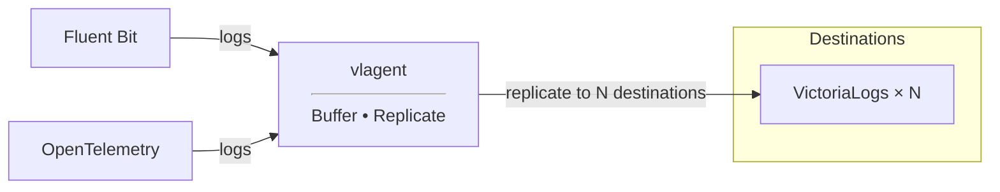

There are three ways to deliver data to VictoriaStack - pick the one that matches the pipeline you already have:

| Path                                      | Use it when                                                                                                                                    |
|-------------------------------------------|------------------------------------------------------------------------------------------------------------------------------------------------|
| [OpenTelemetry Collector](#opentelemetry) | you already collect telemetry with OpenTelemetry, or you start from scratch and want a single pipeline for all three signals                   |
| [Agents you already run](#integrations)   | Prometheus, Vector, Grafana Alloy, Fluent Bit, Telegraf and others can push to VictoriaStack directly                                          |
| [vmagent and vlagent](#native-ingestion)  | you want reliable and cost-efficient delivery: high throughput, on-disk buffering, replication between installations, and traffic compression. |

<br>

**The paths combine**: OpenTelemetry Collector or a third-party agent can push to vmagent or vlagent, which buffer the
data and forward it to the databases. That keeps the existing collection setup and still gets the delivery guarantees of
the native agents.

## OpenTelemetry

See the example of the OpenTelemetry Collector configuration below:
```yaml
receivers:
  otlp:
    protocols:
      grpc:
        endpoint: 0.0.0.0:4317

exporters:
  otlp_http/vm-metrics: { metrics_endpoint: http://victoriametrics:8428/opentelemetry/v1/metrics }
  otlp_http/vm-logs:    { logs_endpoint: http://victorialogs:9428/insert/opentelemetry/v1/logs }
  otlp_http/vm-traces:  { traces_endpoint: http://victoriatraces:10428/insert/opentelemetry/v1/traces }

service:
  pipelines:
    logs:    { receivers: [ otlp ], exporters: [ otlp_http/vm-logs ] }
    traces:  { receivers: [ otlp ], exporters: [ otlp_http/vm-traces ] }
    metrics: { receivers: [ otlp ], exporters: [ otlp_http/vm-metrics ] }
```

Here, OpenTelemetry Collector receives signals via the gRPC protocol,
and then forwards data to VictoriaStack via HTTP endpoints:
* `http://victoriametrics:8428/opentelemetry/v1/metrics` for metrics
* `http://victorialogs:9428/insert/opentelemetry/v1/logs` for logs
* `http://victoriatraces:10428/insert/opentelemetry/v1/traces` for traces



That's it! Generally, no additional configuration is required. However, there are some tweaks that can be applied
to each integration. See the following docs for more details:
* [VictoriaMetrics OpenTelemetry Setup](https://docs.victoriametrics.com/victoriametrics/integrations/opentelemetry/)
* [VictoriaLogs OpenTelemetry Setup](https://docs.victoriametrics.com/victorialogs/data-ingestion/opentelemetry/)
* [VictoriaTraces OpenTelemetry Setup](https://docs.victoriametrics.com/victoriatraces/data-ingestion/opentelemetry/)

> See integration examples OpenTelemetry Collector for [single-node](https://github.com/VictoriaMetrics/VictoriaStack/blob/main/deployment/otelcol-single-node.yml)
> and [clustered](https://github.com/VictoriaMetrics/VictoriaStack/blob/main/deployment/otelcol-cluster.yml) VictoriaStack.

## Integrations

Just like with [OpenTelemetry Collector](#opentelemetry), the easiest way to start ingesting data is to integrate with
telemetry agents that you already have in place. Prometheus and Grafana Alloy for metrics, Vector or Filebeat for logs -
all these agents can push directly to VictoriaStack:

* VictoriaMetrics: [Prometheus, Vector, Grafana Alloy, Telegraf...](https://docs.victoriametrics.com/victoriametrics/data-ingestion/)
* VictoriaLogs: [Filebeat, Logstash, Vector, Promtail, Elasticsearch, Telegraf...](https://docs.victoriametrics.com/victorialogs/data-ingestion/)

If you already run Prometheus, adding VictoriaMetrics as
a [`remote_write`](https://docs.victoriametrics.com/victoriametrics/integrations/prometheus/) target is a two-line change
to make Prometheus forward collected metrics to VictoriaStack:

```yaml
remote_write:
  - url: http://victoriametrics:8428/api/v1/write
```

Prometheus keeps scraping and evaluating rules as before, while VictoriaMetrics stores the data for the long term.
The same endpoint accepts data from anything else that speaks the Prometheus remote write protocol.

VictoriaTraces only supports integration with [OpenTelemetry](https://docs.victoriametrics.com/victoriatraces/data-ingestion/).

## Ingestion protocols

Each database has its own list of supported ingestion protocols. These are the most suitable for each type of signal:

* VictoriaMetrics: [InfluxDB line, CSV, JSON...](https://docs.victoriametrics.com/victoriametrics/single-server-victoriametrics/#how-to-import-time-series-data)
* VictoriaLogs: [JSON, Loki, Journald](https://docs.victoriametrics.com/victorialogs/data-ingestion/#http-apis)

VictoriaTraces only supports integration with [OpenTelemetry](https://docs.victoriametrics.com/victoriatraces/data-ingestion/).

## Cluster and multitenancy

The examples above target single-node databases and the default tenant. Two things change the endpoint.

**Clustered databases accept data on their insert components:** `vminsert`, `vlinsert`, and `vtinsert`. Only the address
changes, the paths stay the same:

| Signal      | Single-node                                                   | Clustered                                              |
|-------------|---------------------------------------------------------------|--------------------------------------------------------|
| **Metrics** | `http://victoriametrics:8428/api/v1/write`                     | `http://vminsert:8480/insert/prometheus/api/v1/write`  |
| **Logs**    | `http://victorialogs:9428/insert/opentelemetry/v1/logs`        | `http://vlinsert:9428/insert/opentelemetry/v1/logs`    |
| **Traces**  | `http://victoriatraces:10428/insert/opentelemetry/v1/traces`   | `http://vtinsert:10428/insert/opentelemetry/v1/traces` |

<br>

In clustered mode you will have multiple replicas for insert components. Put [vmauth](http://localhost:1313/victoriastack/access-control/)
in front of them to control access, balance load, and have a single ingestion endpoint:
```yaml
unauthorized_user:
  url_map:
    # VictoriaMetrics writes
    - src_paths: ["/metrics/insert/.*"]
      drop_src_path_prefix_parts: 1
      url_prefix:
        - "http://vminsert-1:8480"
        - "http://vminsert-2:8480"

    # VictoriaLogs writes
    - src_paths: ["/logs/insert/.*"]
      drop_src_path_prefix_parts: 1
      url_prefix:
        - "http://vlinsert-1:9428"
        - "http://vlinsert-2:9428"

    # VictoriaTraces writes
    - src_paths: [ "/traces/insert/.*" ]
      drop_src_path_prefix_parts: 1
      url_prefix:
        - "http://vtinsert-1:10428"
        - "http://vtinsert-2:10428"
```

With the configuration above, vmauth will provide a single endpoint for accepting write requests and balancing them across
the replicas:
* `http://vmauth:8427/metrics/insert/*` for metrics,
* `http://vmauth:8427/logs/insert/*` for logs,
* `http://vmauth:8427/traces/insert/*` for traces.

The [clustered demo](https://github.com/VictoriaMetrics/VictoriaStack/blob/main/deployment/vmauth-cluster.yml) runs
exactly this vmauth configuration, and its
[OpenTelemetry Collector](https://github.com/VictoriaMetrics/VictoriaStack/blob/main/deployment/otelcol-cluster.yml)
writes to these endpoints.

**Tenants are specified with HTTP headers** in the same way in all three databases. Set `AccountID` and `ProjectID` on the
write request, for example in an OpenTelemetry Collector exporter:

```yaml
exporters:
  otlp_http/vm-logs: { logs_endpoint: http://vmauth:8427/logs/insert/opentelemetry/v1/logs, headers: { AccountID: "0", ProjectID: "0" } }
```

Requests without these headers write to the default tenant `0:0`.

> Note: VictoriaMetrics supports [multitenancy](http://localhost:1313/victoriastack/multitenancy/) only in the cluster mode.

// TODO: READINESS: enable headers multitenancy by default https://github.com/VictoriaMetrics/VictoriaMetrics/issues/11365

## Native Ingestion

// TODO: READINESS: add VTagent form optimized ingestion path

VictoriaStack supports variety of ingestion protocols, that makes it easy to integrate with existing installations.
But for achieving cost-efficiency, high throughput, reliable on-disk buffering, replication and traffic compression
we recommend using VictoriaStack agents that were specifically designed for this purpose.

VictoriaStack provides the following native agents:
- [vmagent](#vmagent) for metrics
- [vlagent](#vlagent) for logs
// TODO: replace relative links with absolute

### vmagent

[vmagent](https://docs.victoriametrics.com/victoriametrics/vmagent/) is an agent for collecting, receiving and forwarding
metrics to the specified destinations. Its core features are the following:
- [drop-in replacement for Prometheus](https://prometheus.io/): vmagent supports [Prometheus service discovery](https://docs.victoriametrics.com/victoriametrics/sd_configs/),
  [scraping configs](https://docs.victoriametrics.com/victoriametrics/scrape_config_examples/), [relabeling](https://docs.victoriametrics.com/victoriametrics/relabeling/).
- [on-disk buffering](https://docs.victoriametrics.com/victoriametrics/vmagent/#on-disk-persistence): stores unsent metrics
  in the local disk until the remote destination is available.
- [replication](https://docs.victoriametrics.com/victoriametrics/vmagent/#replication-and-high-availability) and 
  [sharding](https://docs.victoriametrics.com/victoriametrics/vmagent/#sharding-among-remote-storages): allows building 
  High Available and horizontally scalable pipelines for metrics delivery
- is way more compute efficient than Prometheus or OpenTelemetry Collector for collection and forwarding metrics

Additionally to features above, vmagent supports all the same ingestion protocols for metrics as VictoriaMetrics. 
Which makes it a perfect entry point in delivery pipeline for metrics:


As an entry point, vmagent can filter, [deduplicate](https://docs.victoriametrics.com/victoriametrics/vmagent/#flexible-deduplication),
[pre-aggregate](https://docs.victoriametrics.com/victoriametrics/stream-aggregation/), rate-limit ingested samples and 
[limit cardinality](https://docs.victoriametrics.com/victoriametrics/vmagent/#cardinality-limiter).

The forwarded traffic is [additionally compressed](https://docs.victoriametrics.com/victoriametrics/vmagent/#victoriametrics-remote-write-protocol) 
resulting into 2x-5x network bandwidth reduction. See blogpost [Save network costs with VictoriaMetrics remote write protocol](https://victoriametrics.com/blog/victoriametrics-remote-write/).

### vlagent

[vlagent](https://docs.victoriametrics.com/victorialogs/vlagent/) is an agent for collection logs from various sources
and forwarding them to the specified destinations. Its core features are the following:
- [collecting logs from K8s pods](https://docs.victoriametrics.com/victorialogs/vlagent/#collect-kubernetes-pod-logs):
  native support for collecting logs from Kubernetes Pods
- [on-disk buffering and replication](https://docs.victoriametrics.com/victorialogs/vlagent/#replication-and-high-availability):
  allows building High Available scalable pipelines for logs delivery
- [outstanding performance](https://victoriametrics.com/blog/log-collectors-benchmark-2026/): significant
  savings on compute for collecting and delivering logs

Additionally to features above, vlagent supports all the same ingestion protocols for logs as VictoriaLogs.
Which makes it a perfect entry point in delivery pipeline for reliability:


vlagent is recommended to use for achieving [high availability in VictoriaLogs](https://docs.victoriametrics.com/victorialogs/#high-availability).