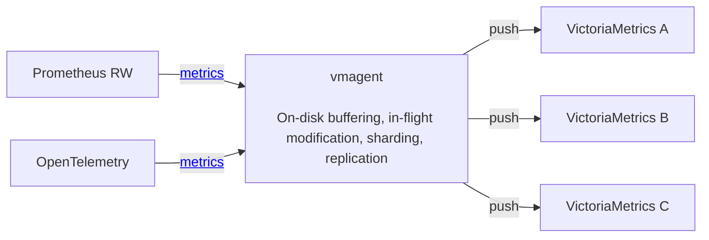
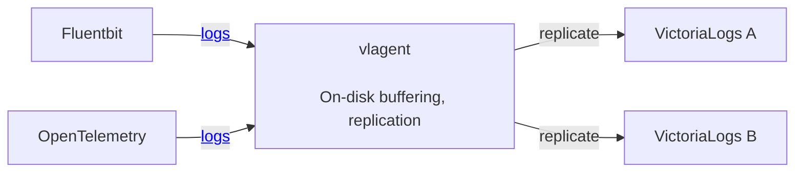

The easiest way to ingest data into VictoriaStack is to [integrate with the OpenTelemetry Collector](https://docs.victoriametrics.com/opentelemetry/),
as it can forward all three types of signals at once.

## OpenTelemetry

See the example of the OpenTelemetry Collector configuration below:
```yaml
receivers:
  otlp:
    protocols:
      grpc:
        endpoint: 0.0.0.0:4317

exporters:
  otlp_http/vm-metrics: { metrics_endpoint: http://victoriametrics:8428/opentelemetry/v1/metrics }
  otlp_http/vm-logs:    { logs_endpoint: http://victorialogs:9428/insert/opentelemetry/v1/logs }
  otlp_http/vm-traces:  { traces_endpoint: http://victoriatraces:10428/insert/opentelemetry/v1/traces }

service:
  pipelines:
    logs:    { receivers: [ otlp ], exporters: [ otlp_http/vm-logs ] }
    traces:  { receivers: [ otlp ], exporters: [ otlp_http/vm-traces ] }
    metrics: { receivers: [ otlp ], exporters: [ otlp_http/vm-metrics ] }
```

In the example above, the OpenTelemetry Collector receives signals via the gRPC protocol,
and forwards them to VictoriaStack via HTTP endpoints:
* `http://victoriametrics:8428/opentelemetry/v1/metrics` for metrics
* `http://victorialogs:9428/insert/opentelemetry/v1/logs` for logs
* `http://victoriatraces:10428/insert/opentelemetry/v1/traces` for traces

That's it! Generally, no additional configuration is required. However, there are some tweaks that can be applied
to each integration. See the following docs for more details:
* [VictoriaMetrics OpenTelemetry Setup](https://docs.victoriametrics.com/victoriametrics/integrations/opentelemetry/)
* [VictoriaLogs OpenTelemetry Setup](https://docs.victoriametrics.com/victorialogs/data-ingestion/opentelemetry/)
* [VictoriaTraces OpenTelemetry Setup](https://docs.victoriametrics.com/victoriatraces/data-ingestion/opentelemetry/)

> See integration examples OpenTelemetry Collector for [single-node](https://github.com/VictoriaMetrics/VictoriaStack/blob/main/deployment/otelcol-single-node.yml)
> and [clustered](https://github.com/VictoriaMetrics/VictoriaStack/blob/main/deployment/otelcol-cluster.yml) VictoriaStack.

## Integrations

Just like with [OpenTelemetry Collector](), the easiest way to start ingesting data is to integrate with telemetry agents
that you already have in place. Do you use Prometheus or Grafana Alloy for metrics? Do you use Vector or Filebeat for logs?
All these agents can push directly to VictoriaStack:

* VictoriaMetrics: [Prometheus, Vector, Grafana Alloy, Telegraf...](https://docs.victoriametrics.com/victoriametrics/data-ingestion/)
* VictoriaLogs: [Filebeat, Logstash, Vector, Promtail, Elasticsearch, Telegraf...](https://docs.victoriametrics.com/victorialogs/data-ingestion/)

VictoriaTraces only supports integration with [OpenTelemetry](https://docs.victoriametrics.com/victoriatraces/data-ingestion/).

## Ingestion protocols

Each database has its own list of supported ingestion protocols. These are the most suitable for each type of signal:

* VictoriaMetrics: [InfluxDB line, CSV, JSON...](https://docs.victoriametrics.com/victoriametrics/single-server-victoriametrics/#how-to-import-time-series-data)
* VictoriaLogs: [JSON, Loki, Journald](https://docs.victoriametrics.com/victorialogs/data-ingestion/#http-apis)

VictoriaTraces only supports integration with [OpenTelemetry](https://docs.victoriametrics.com/victoriatraces/data-ingestion/).

## Native Ingestion

VictoriaStack supports variety of ingestion protocols, that makes it easy to integrate with existing installations.
But for achieving cost-efficiency, high throughput, reliable on-disk buffering, replication and traffic compression
we recommend using VictoriaStack agents that were specifically designed for this purpose.

VictoriaStack provides the following native agents:
- [vmagent](#vmagent) for metrics
- [vlagent](#vlagent) for logs
// TODO: replace relative links with absolute

### vmagent

[vmagent](https://docs.victoriametrics.com/victoriametrics/vmagent/) is an agent for collecting, receiving and forwarding
metrics to the specified destinations. Its core features are the following:
- [drop-in replacement for Prometheus](https://prometheus.io/): vmagent supports [Prometheus service discovery](https://docs.victoriametrics.com/victoriametrics/sd_configs/),
  [scraping configs](https://docs.victoriametrics.com/victoriametrics/scrape_config_examples/), [relabeling](https://docs.victoriametrics.com/victoriametrics/relabeling/).
- [on-disk buffering](https://docs.victoriametrics.com/victoriametrics/vmagent/#on-disk-persistence): stores unsent metrics
  in the local disk until the remote destination is available.
- [replication](https://docs.victoriametrics.com/victoriametrics/vmagent/#replication-and-high-availability) and 
  [sharding](https://docs.victoriametrics.com/victoriametrics/vmagent/#sharding-among-remote-storages): allows building 
  High Available and horizontally scalable pipelines for metrics delivery
- is way more compute efficient than Prometheus or OpenTelemetry Collector for collection and forwarding metrics

Additionally to features above, vmagent supports all the same ingestion protocols for metrics as VictoriaMetrics. 
Which makes it a perfect entry point in delivery pipeline for metrics:


As an entry point, vmagent can filter, [deduplicate](https://docs.victoriametrics.com/victoriametrics/vmagent/#flexible-deduplication),
[pre-aggregate](https://docs.victoriametrics.com/victoriametrics/stream-aggregation/), rate-limit ingested samples and 
[limit cardinality](https://docs.victoriametrics.com/victoriametrics/vmagent/#cardinality-limiter).

The forwarded traffic is [additionally compressed](https://docs.victoriametrics.com/victoriametrics/vmagent/#victoriametrics-remote-write-protocol) 
resulting into 2x-5x network bandwidth reduction. See blogpost [Save network costs with VictoriaMetrics remote write protocol](https://victoriametrics.com/blog/victoriametrics-remote-write/).

### vlagent

[vlagent](https://docs.victoriametrics.com/victorialogs/vlagent/) is an agent for collection logs from various sources
and forwarding them to the specified destinations. Its core features are the following:
- [collecting logs from K8s pods](https://docs.victoriametrics.com/victorialogs/vlagent/#collect-kubernetes-pod-logs):
  native support for collecting logs from Kubernetes Pods
- [on-disk buffering and replication](https://docs.victoriametrics.com/victorialogs/vlagent/#replication-and-high-availability):
  allows building High Available scalable pipelines for logs delivery
- [outstanding performance](https://victoriametrics.com/blog/log-collectors-benchmark-2026/): results in significant
  savings on compute for collecting and delivering logs

Additionally to features above, vlagent supports all the same ingestion protocols for logs as VictoriaLogs.
Which makes it a perfect entry point in delivery pipeline for reliability:
