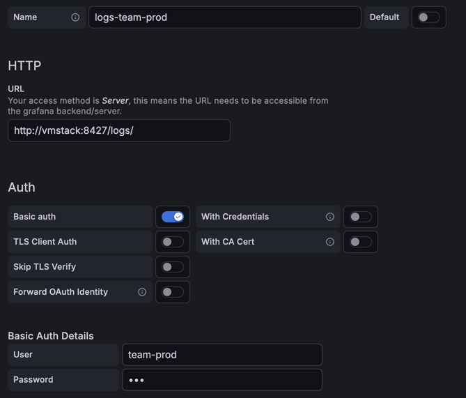
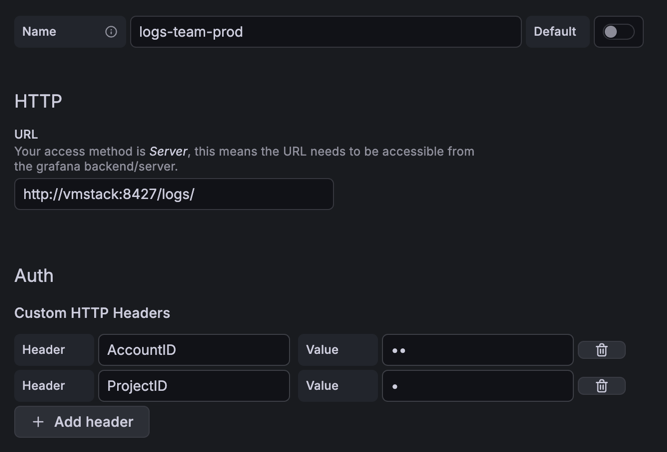

Multitenancy lets a single VictoriaStack installation store data for many isolated data groups, such as teams,
environments, or customers. Each group is a **tenant**, and every tenant sees only its own metrics, logs, and traces.

VictoriaMetrics, VictoriaLogs, and VictoriaTraces share the same tenant model. The only per-signal difference is how a
request selects its tenant. This page first explains the shared model, then the per-signal specifics.

> VictoriaMetrics supports multitenancy only in [cluster mode](https://docs.victoriametrics.com/victoriametrics/cluster-victoriametrics/#multitenancy).
> The single-node version stores all data in one tenant. The rest of this page assumes VictoriaMetrics runs in cluster mode.

## The tenant model

A tenant is identified by an `(AccountID, ProjectID)` pair. Both are arbitrary 32-bit unsigned integers in the
range `[0 .. 2^32)`. `AccountID` groups a top-level owner such as a team; `ProjectID` is optional and can subdivide an account into sub-groups such as environments.

The same rules apply to all three databases:

- **Tenants isolate data.** A query against one tenant never returns data from another tenant.
- **Tenants are created on first write.** No need to pre-provision. Writing the first data point to
  `AccountID=42` creates that tenant.
- **Overhead is low.** It is ok to have thousands of tenants. Resource usage depends on the total number
  of active time series, log streams, and spans, not on the number of tenants.
- **Default tenant is `0:0`.** A request that specifies no tenant reads and writes tenant `AccountID=0, ProjectID=0`.

[//]: # (The tenant ID can have only numeric value, no string values or other associated metadata. It is expected, that)

[//]: # (such a metadata will be assigned in the datasource configuration)

[//]: # (The databases store no other information about a tenant, such as its name, limits, or owner. See [access control]&#40;&#41; for how to map users to tenants.)

## Assigning tenants via HTTP headers

The easiest way to assign tenants is to use the `AccountID` and `ProjectID` request HTTP headers.
For example, the following request writes metrics to `AccountID=42` and `ProjectID=0`:
```sh
curl -X POST http://<vmstack>:8427/metrics/insert/prometheus/api/v1/import/prometheus \
 -d 'up{instance="foo"} 123' \
 --header "AccountID: 42" \
 --header "ProjectID: 0"
```

Once the request completes, tenant `AccountID=42, ProjectID=0` will be automatically created and populated with the
supplied metrics.

To query the results, run the following command:
```sh
curl 'http://<vmstack>:8427/select/prometheus/api/v1/query' \
 -d 'query=up' \
 --header "AccountID: 42" \
 --header "ProjectID: 0" 
```

It works in the same way for logs and traces: use HTTP headers to specify the tenant on writes or reads.

## Access control per-tenant

With tenants in place, the access control can be enforced via vmauth:
```yaml
users:
  - username: team-prod
    password: "***"
    url_map:
      - src_paths: ["/logs/.*"]
        url_prefix: "http://victorialogs:9428/"
        drop_src_path_prefix_parts: 1
        headers:
        - "AccountID: 42"
        - "ProjectID: 0"
```

> See more about tenants access control [here](https://docs.victoriametrics.com/victoriastack/access-control/#tenants-filtering).

With the configuration above, all requests with Basic Auth credentials of `team-prod` will get access to logs and traces
of the tenant `AccountID=42, ProjectID=0` only. This example also shows how to associate a string username with a
numeric tenant: `team-prod` maps to `AccountID=42, ProjectID=0`.

In a similar way, data access can be controlled via Grafana in datasource settings by setting Basic Auth:


{width="500"}

Or by setting HTTP headers:


{width="500"}


## Assigning tenants via fields

// TODO: add once https://github.com/VictoriaMetrics/VictoriaLogs/issues/686 is ready


// TODO: make a unified usage dashboards for all signals per-tenant


